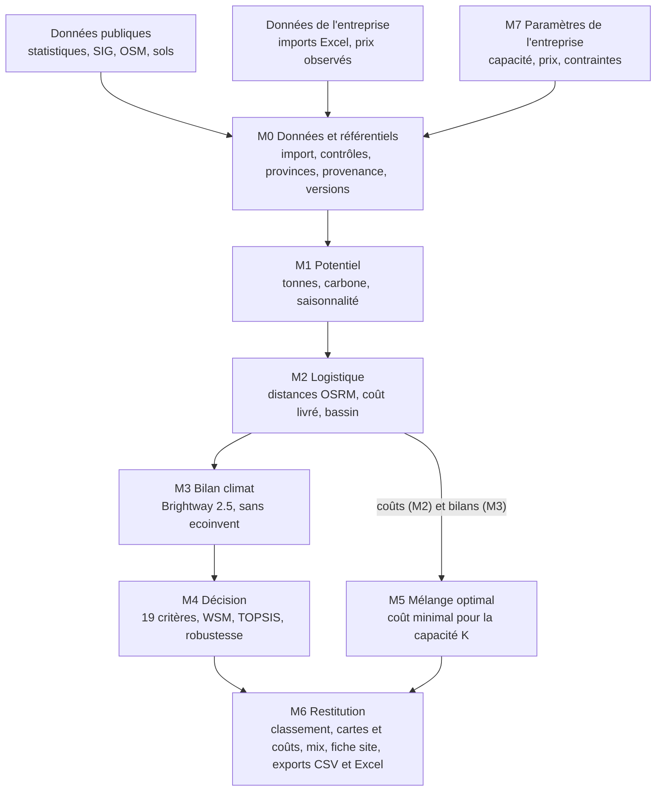
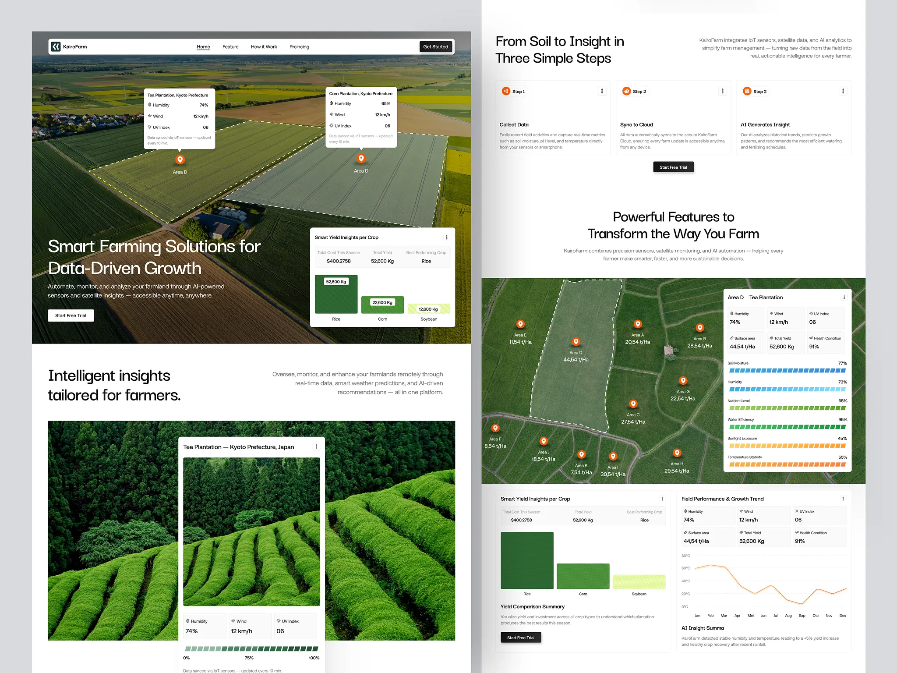

# Cahier des charges — Outil d'aide à la décision pour l'implantation d'unités de biochar au Maroc

21 novembre 2026 · Équipe Projet Innovation, École Centrale Casablanca

## 0. Fiche d'identité

Ce document est la spécification de référence de l'outil : Claude Code doit pouvoir générer l'application à partir de lui seul, sans question en suspens.

| Rubrique | Contenu |
| --- | --- |
| Projet | Projet Innovation, 3e édition · École Centrale Casablanca |
| Commanditaire | Atlantic Biochar (unité de production à l'Agropolis de Meknès, mise en service visée début 2027) |
| Équipe | AMOU Sabi Aurel, DYAZ Hajar, EL ALLAOUI Mohamed El Mehdi, JANATI Ilias, LESSIQ Ilyass |
| Produit | Outil local d'aide à la décision multicritère pour classer les gisements de biomasse et les sites d'implantation d'unités de biochar au Maroc |
| Version | 1.0 · 21 novembre 2026 |
| Documents sources | Fiche de soumission Atlantic Biochar · Poster scientifique du 21 octobre 2026 · Ressources techniques transmises par l'entreprise · Échanges avec l'équipe |
| Usage | Spécification fonctionnelle et technique pour le développement assisté par Claude Code |

## 1. Synthèse

L'outil répond à une question : où implanter les prochaines unités de biochar d'Atlantic Biochar, et avec quel mélange de résidus agricoles ? Il calcule, par province et par résidu, la biomasse réellement mobilisable, son coût livré à l'usine et son bilan climat, puis classe les sites candidats et les gisements selon 19 critères pondérés par l'entreprise.

| Indicateur | Valeur |
| --- | --- |
| Modules fonctionnels | 8 (M0 à M7) |
| Critères de décision | 19, répartis sur 7 axes |
| Cas d'utilisation | 29 |
| Maille géographique | Province et préfecture (75 unités), avec repli régional documenté |
| Résidus couverts | 13 types de résidus agricoles et agro-industriels |
| Utilisateurs | Équipe Atlantic Biochar, sur un poste local |
| Technologie | Calculs en Python (FastAPI, Brightway 2.5, GeoPandas, OSRM) · interface web React et MapLibre |

Cinq choix structurent le produit :

- **Des données réelles uniquement.** L'outil est livré avec des statistiques officielles et des valeurs publiées, chacune avec sa source ; aucune donnée fictive n'est utilisée (section 7.2).
- **Une entreprise autonome sur ses données.** L'équipe d'Atlantic Biochar met à jour les données elle-même par modèles Excel, saisie directe et prix observés, avec un historique des versions (section 7.3).
- **Les paramètres de l'entreprise au cœur de l'algorithme.** Capacité, prix plafond, température de pyrolyse, prix de vente du biochar et du crédit carbone, contraintes de matière : l'entreprise les règle dans l'interface et voit immédiatement leur effet sur le classement des sites (section 14.1).
- **Un outil local et sans compte.** Il tourne sur un poste avec Python, sans serveur ni authentification.
- **Une ACV limitée au climat et sans ecoinvent.** L'inventaire est construit avec Brightway à partir de facteurs d'émission publics et de la littérature ; le bilan est calculé au standard neutre (RG-07).

## 2. Contexte, problématique et objectifs

Atlantic Biochar construit la première unité de production de biochar du Maroc, à l'Agropolis de Meknès. Le biochar est produit par pyrolyse de résidus agricoles et vendu de deux façons : comme amendement des sols et comme crédits carbone de séquestration. La première unité fonctionnera au bois de taille et d'élagage ; les suivantes viseront d'autres gisements dont la disponibilité, le coût et le comportement en pyrolyse restent à établir.

**Constat.** Un tonnage théorique n'est pas un tonnage mobilisable. Les grignons d'olive sont déjà largement achetés par les hammams, les chaudières et les briqueteries. Le bois de taille est disponible et bon marché, mais peu dense et dispersé. Le transport peut annuler la marge au-delà d'un certain rayon.

**Problématique retenue (poster du 21 octobre 2026).** À partir des données sur les gisements au Maroc, comment concevoir un outil d'aide à la décision multicritère qui calcule et classe les sites afin d'identifier l'implantation optimale d'une unité de biochar ?

**Objectifs de l'outil**

1. Estimer, pour chaque couple province × résidu, le tonnage mobilisable, son contenu carbone et sa saisonnalité.
2. Calculer, pour chaque site candidat, la distance routière et le coût livré à l'usine de chaque gisement, ainsi que le bassin d'approvisionnement économique.
3. Calculer le bilan climat du berceau à la tombe (collecte, transport, prétraitement, pyrolyse, épandage) de chaque chaîne.
4. Classer les sites candidats selon des critères et des poids réglables, avec plusieurs méthodes multicritères et une analyse de robustesse.
5. Proposer, pour un site et une capacité visée, le mélange de résidus le moins coûteux qui respecte les contraintes de l'entreprise.

**Correspondance avec les livrables demandés par l'entreprise**

| Livrable de la fiche Atlantic Biochar | Réponse de l'outil |
| --- | --- |
| Cartographie des gisements par région, en tonnages mobilisables et contenu carbone | Module M1, au niveau provincial |
| Description des filières existantes | Paramètres de concurrence d'usage (M0, M7), alimentés par l'enquête de terrain de l'équipe |
| Schémas logistiques pour les gisements non valorisés | Module M2 (collecte directe vers l'usine : distances, coût livré, bassin) |
| Modèle ACV paramétrable par couple région × résidu | Module M3, par couple province × résidu |
| Outil de scénarios sur le mix matière | Modules M5 et M7 |
| Classement argumenté des sites | Module M4 |

## 3. Conventions du document

Chaque exigence porte un identifiant, une priorité et une source, afin de distinguer ce que l'entreprise demande de ce que l'équipe propose.

**Sources des exigences**

| Repère | Source |
| --- | --- |
| AB | Fiche de soumission Atlantic Biochar (sujet, modules de travail, livrables) |
| RT | Ressources techniques transmises par l'entreprise (Brightway, sources de données, articles) |
| POS | Poster scientifique de l'équipe du 21 octobre 2026 |
| ÉQ | Décisions prises par l'équipe (outil local, Python, province, pas de licence ecoinvent) |
| PROP | Proposition d'analyse de l'équipe, nécessaire au fonctionnement ou à la rigueur académique |

**Priorités**

| Priorité | Signification |
| --- | --- |
| P1 · MVP | Indispensable : sans elle, l'outil ne répond pas à la problématique |

Toutes les exigences de ce cahier sont de priorité P1 : l'outil est le MVP des lots 1 à 6 (section 17).

**Codification**

- Modules : M0 à M7.
- Cas d'utilisation : UC-\[module\]-\[numéro\], par exemple UC-POT-01. Préfixes : DAT (données), POT (potentiel), LOG (logistique), ACV, DEC (décision), MIX (mélange), RES (restitution), SCN (scénarios), ENT (entreprise). UC-00 et UC-01 sont transverses. Les numéros manquants correspondent à des cas retirés le 23/11/2026 (compléments et perspectives non réalisés).
- Critères de décision : une lettre d'axe et un numéro, de A1 à G1.
- Règles de gestion : RG-01, RG-02… · Exigences non fonctionnelles : ENF-01… · Paramètres : PAR-01…

**Statut des données** (affiché dans l'outil pour chaque valeur, voir RG-03)

| Statut | Signification |
| --- | --- |
| Mesurée | Statistique officielle au niveau provincial, utilisée telle quelle |
| Estimée | Valeur calculée par désagrégation (région vers province) ou par modèle |
| Littérature | Valeur par défaut tirée d'une publication, à confirmer |
| Terrain | Valeur saisie à partir de l'enquête de l'équipe ou de l'entreprise |
| Hypothèse | Valeur fixée par convention, sans source directe |

## 4. Périmètre

L'outil couvre tout le Maroc au niveau provincial, 13 types de résidus et la chaîne complète du champ à l'épandage du biochar ; il ne produit pas les données de terrain, il les intègre.

**Inclus**

- Les 12 régions et les 75 préfectures et provinces du découpage administratif en vigueur (RGPH 2024).
- Les résidus suivants :

| Code | Résidu | Culture ou filière d'origine |
| --- | --- | --- |
| R01 | Bois de taille d'olivier | Olivier |
| R02 | Bois de taille d'agrumes | Agrumes |
| R03 | Sarments de vigne | Vigne |
| R04 | Bois de taille d'amandier et de rosacées | Amandier, pommier, abricotier |
| R05 | Grignons d'olive | Huileries |
| R06 | Palmes, rachis et régimes de palmier dattier | Palmier dattier |
| R07 | Noyaux et déchets de dattes | Conditionnement des dattes |
| R08 | Coques d'amande | Cassage d'amandes |
| R09 | Coques d'argan | Production d'huile d'argan |
| R10 | Tiges de tomate sous serre | Maraîchage sous serre |
| R11 | Balles de riz | Rizeries |
| R12 | Pulpes de betterave | Sucreries |
| R13 | Pailles céréalières | Blé tendre, blé dur, orge |

- La chaîne : collecte, prétraitement (broyage), transport, pyrolyse, épandage du biochar.
- Les sites candidats : chefs-lieux des 75 provinces, agropoles (Meknès, Berkane, Tadla, Souss, Loukkos) et sites ajoutés par l'utilisateur.

**Exclus**

- L'enquête de terrain sur les filières (modules 2 et 3 de la fiche) : l'outil en reçoit les résultats sous forme de paramètres.
- Les impacts environnementaux autres que le changement climatique (eau, particules, toxicité).
- Le résidu d'agrumes de transformation (pulpes, écorces) et l'eucalyptus, listés par la fiche : leurs données sont plus difficiles à obtenir.
- Les standards carbone (Verra VM0044, Puro.earth, EBC C-Sink) : le bilan est calculé au standard neutre.
- Les schémas logistiques avec plateforme de densification, la saisonnalité et la couverture mensuelle du mélange, l'incertitude par Monte Carlo sur les données, les méthodes de surclassement et les poids objectifs, le rapport HTML et l'export des cartes, le rafraîchissement automatique des sources et les alertes de fraîcheur, la comparaison de scénarios, la localisation continue, ecoinvent et le choix simultané de plusieurs unités (compléments et perspectives non réalisés).
- Le dimensionnement technique du réacteur de pyrolyse et le business plan complet.
- La gestion multi-utilisateurs, les comptes et l'hébergement en ligne.
- Le dépôt d'un dossier de certification carbone.

**Hypothèses structurantes**

- H1 : la province est l'unité d'analyse ; les gisements d'une province sont rattachés à son centroïde agricole (barycentre des surfaces cultivées), pas à son centre administratif.
- H2 : l'année de référence est la moyenne des 5 dernières campagnes disponibles.
- H3 : le transport se fait par camion sur le réseau routier ; le rail et le transport maritime sont exclus.
- H4 : l'usine de Meknès est un site imposé que l'outil doit évaluer comme les autres sites.

## 5. Profils utilisateurs

L'outil n'a pas de comptes : un seul type d'installation, mais trois usages distincts qui guident l'ergonomie.

| Profil | Qui | Ce qu'il fait dans l'outil | Niveau technique |
| --- | --- | --- | --- |
| Décideur | Direction d'Atlantic Biochar | Règle les paramètres de l'entreprise (capacité, prix plafond, prix de vente, contraintes de matière) et les priorités (poids, seuils), lit le classement et la fiche d'un site, exporte un rapport | Non technique : aucune ligne de code |
| Analyste | Ingénieur ou chargé d'études de l'entreprise | Met à jour les données (modèles Excel, prix observés, saisie directe), modifie les paramètres techniques, enregistre des scénarios, lance l'analyse de robustesse | Maîtrise des notions d'ACV et de SIG |
| Mainteneur | Équipe projet, puis un développeur de l'entreprise | Met à jour les sources de données, relance le pipeline de préparation, ajoute un résidu ou un critère | Python |

**Conséquences pour l'interface**

- Le décideur doit obtenir un classement en moins de 3 actions après avoir saisi les paramètres de l'entreprise.
- Les paramètres techniques sont regroupés dans un écran dédié, séparé des réglages de décision.
- La mise à jour courante des données se fait dans l'interface (section 7.3) ; seules les opérations lourdes (ajout d'une nouvelle source, reconstruction du graphe routier) passent par des scripts.

## 6. Architecture fonctionnelle

L'outil est un pipeline en 8 modules : trois entrées alimentent un socle de données commun, puis quatre calculs successifs mènent au classement des sites, restitué avec le mélange optimal.

*Architecture fonctionnelle · 8 modules*



Le mélange (M5) réutilise les coûts de M2 et les bilans de M3 pour le site choisi ; les paramètres et scénarios (M7) s'appliquent à tous les modules.

| Module | Rôle | Entrées | Sorties | Priorité |
| --- | --- | --- | --- | --- |
| M0 Données et référentiels | Importer, contrôler, harmoniser, désagréger, tracer, versionner les mises à jour de l'entreprise | Sources brutes, CSV saisis | Tables préparées, rapport de contrôle | P1 |
| M1 Potentiel | Calculer les gisements mobilisables | Production, surfaces, propriétés des résidus | Tonnes, carbone, biochar, variabilité interannuelle | P1 |
| M2 Logistique | Distances, coûts livrés, bassins | Gisements, sites, réseau routier | Matrices de distances et de coûts, courbes | P1 |
| M3 Bilan climat | ACV du berceau à la tombe avec Brightway | Gisements, distances, facteurs d'émission | Bilan net et contributions par chaîne | P1 |
| M4 Décision | Critères, pondération, classement, robustesse | Sorties de M1 à M3, données de site | Scores, rangs, probabilités de rang | P1 |
| M5 Mélange optimal | Programme linéaire du mélange de résidus | Coûts, bilans, contraintes | Mélange par résidu et par province | P1 |
| M6 Restitution | Fiches, cartes, exports | Tous les résultats | Écrans, fiche site imprimable, exports CSV et Excel | P1 |
| M7 Paramètres de l'entreprise et scénarios | Lire, modifier, enregistrer, recharger | `config/`, actions de l'utilisateur | Scénarios YAML | P1 |

## 7. Données d'entrée

Toutes les sources du MVP sont gratuites et téléchargeables ; Statagri doit être ouverte par l'équipe pour confirmer son niveau géographique avant le développement du module M1 ; Production végétale (SRC-01) est nationale (vérifié le 22/11/2026) et ne sert qu'au recoupement.

### 7.1 Catalogue des sources

| ID | Source | Contenu utilisé | Format | Maille | Licence | Priorité |
| --- | --- | --- | --- | --- | --- | --- |
| SRC-01 | [Open Data Maroc — Production végétale 2010-2022](https://data.gov.ma/data/fr/group/agriculture) | Production et superficie par produit, au niveau national : recoupement des totaux seulement | XLSX | Nationale (vérifié le 22/11/2026) | ODbL | P1 |
| SRC-02 | Ministère de l'Agriculture — Statagri | Superficies et productions par culture | Consultation web, export à vérifier | Région ou province | Publique | P1 |
| SRC-03 | HCP — Le Maroc en chiffres, Annuaire statistique | Superficies et productions des principales cultures, recoupement | PDF, XLSX | Nationale et régionale | Publique | P1 |
| SRC-04 | [CROPGRIDS](https://figshare.com/articles/dataset/CROPGRIDS/22491997) | Surfaces récoltées et cultivées de 173 cultures, année 2020 | NetCDF, grille 0,05° | Pixel d'environ 5,6 km | CC BY 4.0 | P1 |
| SRC-05 | [HDX — Frontières administratives du Maroc (HCP)](https://data.humdata.org/dataset/cod-ab-mar) | Polygones des régions et provinces | SHP | Niveaux 0 à 4 | CC BY-IGO | P1 |
| SRC-06 | [Geofabrik — extrait OpenStreetMap Maroc](https://download.geofabrik.de) | Réseau routier, lignes électriques, zones industrielles | PBF, SHP | Vecteur | ODbL | P1 |
| SRC-07 | OSRM (moteur de routage local sur SRC-06) | Matrices de distances et de temps routiers | Service local | Point à point | BSD | P1 |
| SRC-08 | [Base Phyllis](https://www.ecn.nl/phyllis2/) | Carbone, cendres, humidité, PCI de chaque résidu | Web, saisie manuelle | Par matériau | Consultation libre | P1 |
| SRC-09 | [HCP — RGPH 2024](https://www.hcp.ma/Population-legale-du-Royaume-du-Maroc-repartie-par-regions-provinces-et-prefectures-et-communes-selon-les-resultats-du_a3974.html) | Population légale urbaine et rurale | XLSX | Province, commune | Publique | P1 |
| SRC-14 | [Liste positive EBC](https://www.european-biochar.org/en/ct/2) | Éligibilité des résidus à la certification | PDF, saisie manuelle | Par résidu | Consultation libre | P1 |
| SRC-15 | Base Empreinte (ADEME) et GIEC | Facteurs d'émission : gazole, électricité, machines | CSV, saisie manuelle | Par activité | Gratuite avec compte | P1 |
| SRC-16 | Littérature scientifique (section 22) | Ratios résidu/produit, facteurs de disponibilité, rendements de pyrolyse, coûts | Saisie manuelle | Par résidu | — | P1 |
| SRC-17 | Enquête de terrain de l'équipe | Concurrence d'usage, prix d'achat, acteurs des filières | CSV saisi par l'équipe | Province × résidu | Interne | P1 |
| SRC-18 | Communiqués des directions régionales et provinciales de l'agriculture (DRA, DPA), y compris repris par la presse | Production et superficie par culture et par province | Communiqué, article, saisie manuelle | Province | Publique | P1 |
| SRC-19 | HCP — Cartes du RGPH (service WFS rgphencartes.hcp.ma, couches RGPH:regions et RGPH:provinces) | Polygones des 12 régions et 75 provinces du découpage du RGPH 2024 ; géométries, codes et noms (variantes de graphie) utilisés ; les indicateurs du RGPH 2014 ne le sont pas (la population vient de SRC-09) | GeoJSON (WFS) | Région, province | Non déclarée par le HCP ; usage interne et académique, source citée, sans redistribution publique des cartes. Attribution « © Haut-Commissariat au Plan » sous chaque carte | P1 |

**Règles de gestion des données**

- **RG-01 · Données brutes intactes.** Les fichiers téléchargés sont rangés dans `data/raw/` et ne sont jamais modifiés ; tout traitement écrit dans `data/processed/`.
- **RG-02 · Un référentiel unique des provinces.** Chaque source est rattachée à une table de correspondance des noms et codes de provinces (variantes d'orthographe française, arabe translittérée, anciens découpages). Une province non reconnue bloque l'import avec un message explicite.
- **RG-03 · Provenance de chaque valeur.** Chaque valeur numérique utilisée dans un calcul porte sa source (SRC-xx), son année et son statut (Mesurée, Estimée, Littérature, Terrain, Hypothèse).
- **RG-04 · Désagrégation hiérarchique.** Pour chaque culture et chaque campagne, la production d'une province est prise dans cet ordre :
  1. valeur provinciale réelle (DRA, DPA, ORMVA, HCP) : elle garde le statut de sa source ;
  2. sinon, total régional réel moins les provinces de la région déjà connues ; le reste est réparti entre les provinces manquantes au prorata de leur surface CROPGRIDS pour cette culture (statut « Estimée ») ;
  3. sinon, total national (SRC-01) moins les provinces connues, avec la même répartition (statut « Estimée »).

  Chaque valeur estimée garde la trace de la source du total, de la part CROPGRIDS utilisée et de la campagne. Contrôle : la somme des provinces égale le total parent (régional ou national). Une valeur prévisionnelle n'est utilisée que s'il n'existe pas de valeur réalisée pour la même campagne, et elle est signalée. Règle de campagne : une récolte d'automne de l'année civile Y relève de la campagne Y-(Y+1) (par exemple, la récolte d'olives de 2022 relève de la campagne 2022-2023) ; ces valeurs portent « periode = annee_civile ». L'interface affiche un badge « Estimée » sur chaque valeur estimée et permet de filtrer les sites classés uniquement sur des valeurs réelles.
- **RG-05 · Un manifeste des sources.** Le fichier `data/sources.yaml` liste pour chaque source son URL, sa date de téléchargement, sa licence et son empreinte (somme de contrôle).

**Tables de référence** (valeurs initiales en section 14.2, mises à jour par les modèles Excel de la section 7.3)

- `residus.csv` : propriétés de chaque résidu (SRC-08, SRC-14, SRC-16).
- `concurrence.csv` : part déjà utilisée et prix d'achat par province × résidu (SRC-17), avec une valeur par défaut nationale.
- `facteurs_emission.csv` : facteurs d'émission de la chaîne (SRC-15).
- `calendrier.csv` : mois de disponibilité de chaque résidu.

### 7.2 Jeu de données initial

L'outil est livré avec des données réelles uniquement : les sources ouvertes du catalogue, les statistiques provinciales publiées par les directions régionales de l'agriculture, et les valeurs de référence sourcées de la section 14.2. Aucune donnée fictive ou de démonstration n'est utilisée, ni pour développer, ni pour livrer. Les tests utilisent un extrait figé de ces données réelles (quelques provinces), pas des valeurs inventées.

**Exception : mode « Démonstration »** (décision de l'équipe du 23/11/2026, pour la soutenance). Des scénarios de démonstration, rangés dans `scenarios/demo/`, se chargent dans une copie de travail isolée (`data/cache/demo/`). Ils ne complètent que les valeurs « À compléter » et ne fixent que des paramètres d'hypothèse, étiquetés (statut, source ou mention « valeur de démonstration ») et listés avec leur source dans `docs/demo.md`. Tant qu'un scénario de démonstration est chargé, un bandeau « Démonstration — paramètres d'hypothèse, pas un résultat réel » est affiché sur chaque écran et en tête de chaque export et de la fiche site. Le mode Démonstration ne modifie jamais les données réelles ni les saisies de l'entreprise ; « Quitter la démonstration » y revient.

### 7.3 Mise à jour des données par l'entreprise

L'équipe d'Atlantic Biochar met l'outil à jour elle-même, depuis la page « Données », sans écrire de code. Trois outils simples sont fournis ; les sources ouvertes se mettent à jour en relançant `python -m scripts.download` et `python -m scripts.prepare`.

| Outil | Ce que fait l'utilisateur | Ce que fait l'outil | Priorité |
| --- | --- | --- | --- |
| Import par modèle Excel (UC-DAT-06) | Télécharge le modèle Excel d'une table, déjà rempli avec les données actuelles ; modifie ou ajoute des lignes dans Excel ; dépose le fichier | Contrôle colonnes, unités, noms de provinces, valeurs hors fourchette ; affiche les lignes ajoutées, modifiées et rejetées ; enregistre une nouvelle version après validation | P1 |
| Saisie directe (UC-DAT-07) | Corrige une valeur dans un tableau éditable, ou saisit un prix observé (grignons, paille, gazole) sur l'écran « Prix et coûts » | Exige une source et une date ; conserve l'historique des prix et utilise le plus récent | P1 |
| Versions et retour arrière (UC-DAT-08) | Consulte l'historique, compare deux versions, restaure une version | Chaque modification crée une version (auteur, date, commentaire) ; un scénario enregistre la version des données qu'il a utilisée | P1 |

- **RG-17 · Rien n'est écrasé.** Une mise à jour crée toujours une nouvelle version ; les versions précédentes restent consultables et restaurables (`data/versions/`, journal `data/versions.yaml`).
- **RG-18 · Source obligatoire.** Toute valeur saisie ou importée indique sa source (lien, document ou « mesure interne ») et sa date ; sinon elle est refusée.
- **RG-19 · Contrôles avant import.** Une valeur hors du domaine physique de sa colonne (par exemple une humidité supérieure à 100 %, une valeur négative ou une part supérieure à 1) est rejetée. Une valeur hors de la fourchette plausible définie pour sa colonne (par exemple une production 10 fois supérieure à l'année précédente) est signalée et doit être confirmée.

## 8. Modèles de calcul

Les quatre calculs s'enchaînent : le potentiel donne des tonnes par province, la logistique leur donne un coût pour chaque site, l'ACV leur donne un bilan climat, et la décision agrège le tout. Tous les coefficients sont des paramètres modifiables (section 14).

Notations : p = province, r = résidu, c = culture d'origine, j = site candidat, m = mois. Dans le texte, un indice est écrit après un tiret bas (f\_col se lit « f indice col »).

### 8.1 Potentiel mobilisable (module M1)

Le gisement est calculé en tonnes de matière sèche (t MS) par an, en niveaux successifs, sur le modèle des potentiels théorique, technique et disponible de l'étude GIZ.

**Gisement théorique.** Trois modes selon le type de résidu (champ `mode_calcul` de `residus.csv`) :

- Mode « produit » (résidus agro-industriels, pailles) : production de la culture Q (t/an) × ratio résidu/produit RPR.
- Mode « surface » (bois de taille) : surface en production S (ha) × rendement surfacique de résidu Y (par ha et par an).
- Mode « nombre de pieds » (palmes de palmier) : nombre de pieds N × rendement par pied Y^pied (par pied et par an). À défaut de nombre de pieds, N = S × densité de plantation, avec le statut « Estimée ».

Un résidu peut provenir de plusieurs cultures (liste de cultures C\_r) ; son gisement est la somme sur ces cultures.

```latex
T_{p,r} = \sum_{c \in C_r} \left( Q_{p,c} \cdot RPR_r \;\text{ou}\; S_{p,c} \cdot Y_r \;\text{ou}\; N_{p,c} \cdot Y^{pied}_r \right) \cdot (1 - h_r)^{\delta_r}
```

où h\_r est l'humidité à la collecte (fraction de la masse brute) et δ\_r vaut 1 si le ratio du résidu est exprimé en masse brute, 0 s'il est exprimé en matière sèche : (1 − h) n'est jamais appliqué à une valeur déjà en t MS, le calcul dépend de l'unité du ratio.

**Cultures d'origine et cas particuliers** (décisions du 22/11/2026) :

- R04 : amandier, et rosacées fruitières (pommier, poirier, cognassier, abricotier, cerisier, griottier, pêcher et nectarinier, prunier), liste validée par l'équipe.
- R13 : blé, riz, avoine et seigle, avec le coefficient de la source ; l'orge est ajoutée avec le coefficient retenu pour le blé, statut « Hypothèse ».
- R06 : mode « nombre de pieds » ; densité de secours de 7,2 millions de palmiers pour 64 000 ha, soit 112,5 palmiers par ha (le360, 03/11/2024), statut « Estimée ».
- R05 : ratio et humidité du procédé de trituration choisi dans PAR-62 ; la part des olives triturées (0,8) n'est sourcée que pour Fès-Meknès et ne s'applique qu'à cette région : ailleurs, le couple est exclu et listé (RG-06) jusqu'à la saisie d'une part sourcée. R12 : ratio et humidité de la forme des pulpes choisie dans PAR-63 (décisions du 22/11/2026).
- Une valeur de `residus.csv` qui porte une précision est appliquée selon son rôle, décrit dans `config/potentiel.yaml` : culture d'origine, variante choisie par un paramètre, région, valeur de secours, état du matériau. Le statut d'un gisement est le moins fiable des statuts de ses entrées.

**Gisement mobilisable.**

```latex
M_{p,r} = T_{p,r} \cdot f^{col}_r \cdot f^{eco}_r \cdot \left(1 - u_{p,r}\right)
```

- f\_col : taux de collecte techniquement réalisable.
- f\_eco : part prélevable sans appauvrir les sols (la part 1 − f\_eco reste au champ).
- u : part déjà utilisée par un usage concurrent (hammams, chaudières, briqueteries, cimenteries, alimentation animale, compost).

**Contenu carbone et biochar potentiel.**

```latex
C_{p,r} = M_{p,r} \cdot c_r \qquad B_{p,r} = M_{p,r} \cdot y_r
```

où c\_r est la teneur en carbone (fraction de la MS) et y\_r le rendement massique de pyrolyse (t biochar / t MS).

Tant que M attend f\_col, f\_eco ou la part concurrente u, l'outil affiche aussi, nommées comme telles, les valeurs théoriques C\_T = T × c\_r et B\_T = T × y\_r ; C et B restent calculés sur M (décision du 22/11/2026).

**Saisonnalité.** Chaque résidu a un profil mensuel s(r, m), dont la somme sur 12 mois vaut 1, issu de `calendrier.csv`. Le gisement mensuel vaut M(p, r) × s(r, m) ; il sert au critère A4.

**Variabilité interannuelle.** Le calcul est refait pour chaque campagne disponible (2010-2022 au moins) ; le coefficient de variation de M(p, r) est calculé et affiché comme indicateur des gisements.

- **RG-06.** Si une valeur d'entrée manque pour un couple province × résidu, le couple est exclu du calcul et listé dans le rapport de contrôle ; il n'est jamais compté comme zéro.

### 8.2 Logistique (module M2)

**Point de rattachement des gisements.** Le gisement d'une province est placé au barycentre de ses surfaces cultivées pour la culture concernée (pixels CROPGRIDS) ; à défaut, au centroïde géométrique de la province.

**Distance.** d(p, j) est la distance routière en km calculée par OSRM entre le point de rattachement et le site. Si OSRM est indisponible, l'outil utilise la distance à vol d'oiseau × un coefficient de détour (PAR-30, calibré sur la matrice OSRM) et le signale dans l'interface.

**Coût livré à l'usine** (DH par t MS) :

```latex
CL_{p,r,j} = a_{p,r} + k^{col}_r + k^{pre}_r + \frac{F + v \cdot 2\, d_{p,j}}{q_r}
```

- a : prix d'achat au producteur (`concurrence.csv`, 0 si le résidu est aujourd'hui sans valeur).
- k\_col, k\_pre : coûts de collecte et de prétraitement par t MS.
- F : coût fixe par rotation de camion (chargement, déchargement, PAR-61) ; v : coût variable par km ; le facteur 2 compte le retour à vide.
- q : charge utile effective en t MS par camion, limitée par la masse ou par le volume : q = min(charge maximale, densité apparente × volume utile) × (1 − h).

**Courbe d'approvisionnement.** Pour un site j, les couples (p, r) sont triés par coût livré croissant et leurs tonnages cumulés. La courbe donne le coût marginal pour atteindre une capacité K et le tonnage disponible sous un prix plafond (PAR-34).

**Bassin d'approvisionnement.** Ensemble des couples dont le coût livré est inférieur au prix plafond ; il est affiché sur la carte avec l'isodistance correspondante.

### 8.3 ACV, bilan climat (module M3)

**Unité fonctionnelle.** 1 tonne de biochar produite et épandue. Les résultats sont aussi exprimés par tonne de matière sèche entrante et par an pour un site.

**Frontières du système (du berceau à la tombe).** Collecte au champ → prétraitement (broyage) → transport vers l'usine → pyrolyse (électricité, émissions de CH₄ et N₂O) → transport du biochar → épandage → stockage du carbone dans le sol.

**Scénario de référence (devenir alternatif du résidu).** Choisi par résidu dans `residus.csv` : brûlage à l'air libre, décomposition au champ, usage concurrent, ou sans substitution. Pour un usage concurrent, l'acheteur actuel est supposé remplacer le résidu par un combustible fossile (fioul par défaut), ce qui ajoute une charge au bilan. « Sans substitution » (décision de l'équipe du 23/11/2026) s'applique quand aucune source ne documente l'usage actuel du résidu comme combustible : E\_ref = 0. Le CO₂ biogénique est neutre ; seuls le CH₄ et le N₂O du scénario de référence comptent.

**Bilan net** (t CO₂e retirées par t de biochar, positif = retrait net) :

```latex
BN = C_{bc} \cdot F_{perm} \cdot \frac{44}{12} \; - \; \left(E_{col} + E_{pre} + E_{tr} + E_{pyr} + E_{ep}\right) \; + \; E_{ref}
```

- C\_bc : teneur en carbone du biochar (t C / t biochar). Le premier terme est le carbone stocké, converti en CO₂.
- F\_perm : fraction du carbone encore stockée à 100 ans. Par défaut, valeurs par classe de température de pyrolyse du raffinement 2019 des lignes directrices du GIEC (0,65 / 0,80 / 0,89 pour basse, moyenne et haute température), à confirmer.
- E\_col à E\_ep : émissions de chaque étape (t CO₂e / t biochar).
- E\_ref : émissions évitées du scénario de référence, ramenées à la tonne de biochar en divisant par y\_r.

**Méthode d'impact.** Potentiel de réchauffement global à 100 ans du 6e rapport du GIEC, définie dans Brightway comme méthode personnalisée : CO₂ fossile = 1 ; CH₄ fossile = 29,8 ; CH₄ biogénique = 27,0 ; N₂O = 273.

**Mise en œuvre dans Brightway 2.5 (sans ecoinvent)**

- Un projet Brightway `atlantic_biochar` contient une base d'avant-plan `ab_foreground` avec une activité par étape et par résidu, reliée directement aux flux élémentaires de la biosphère.
- Les activités d'arrière-plan (gazole brûlé par t·km, kWh du réseau marocain, broyage par t) sont des activités agrégées construites à partir de `facteurs_emission.csv`.
- Les quantités dépendant de la province et du site (distances, humidité) sont des paramètres Brightway, recalculés pour chaque couple.
- Le projet reste lisible dans Activity Browser 3 : l'analyste peut y inspecter le modèle et ses résultats.

**Analyses**

- Contribution de chaque étape au bilan (graphique en barres).
- **RG-07.** Tout bilan affiché rappelle son unité fonctionnelle, son scénario de référence et le standard appliqué (« neutre »).

## 9. Catalogue des critères de décision

L'outil dispose de 19 critères répartis sur 7 axes ; l'utilisateur choisit ceux qu'il active. 12 sont actifs par défaut, 13 dès que l'entreprise a saisi ses prix de vente (colonne « Défaut »).

**Deux niveaux d'alternatives**

- **Couple province × résidu** (« gisement ») : environ 75 × 13 couples, pour le classement des gisements (couples dont le gisement théorique est calculé ; un couple à qui manque un critère calculé pour d'autres couples est exclu et compté, décision du 23/11/2026).
- **Site candidat** : chefs-lieux, agropoles et sites ajoutés. Un critère de gisement est porté au niveau du site en faisant la moyenne pondérée par le tonnage des couples de son bassin d'approvisionnement (RG-08).

Sens : ↑ = plus c'est élevé, mieux c'est ; ↓ = plus c'est bas, mieux c'est ; Filtre = critère éliminatoire (oui/non). Niveau : G = gisement, S = site.

**A. Ressource**

| ID | Critère | Indicateur et calcul | Unité | Sens | Niveau | Source | Priorité | Défaut |
| --- | --- | --- | --- | --- | --- | --- | --- | --- |
| A1 | Tonnage mobilisable | M(p, r) ; pour un site, somme sur le bassin | t MS/an | ↑ | G, S | SRC-01 à 04, 16 à 18 | P1 | Oui |
| A2 | Densité du gisement | M(p, r) ÷ surface agricole de la province, c'est-à-dire la surface cultivée CROPGRIDS de toutes les cultures (décision du 22/11/2026) | t MS/km² | ↑ | G | SRC-04, 05 | P1 | Non |
| A3 | Part libre d'usage concurrent | 1 − u(p, r) | % | ↑ | G, S | SRC-17 | P1 | Oui |
| A4 | Régularité saisonnière | Nombre de mois où l'approvisionnement couvre au moins 1/12 de la capacité | mois/an | ↑ | S | `calendrier.csv` | P1 | Oui |

**B. Qualité de la matière première**

| ID | Critère | Indicateur et calcul | Unité | Sens | Niveau | Source | Priorité | Défaut |
| --- | --- | --- | --- | --- | --- | --- | --- | --- |
| B1 | Teneur en carbone | c\_r | % MS | ↑ | G, S | SRC-08 | P1 | Non |
| B2 | Taux de cendres | Cendres du résidu | % MS | ↓ | G, S | SRC-08 | P1 | Oui |
| B3 | Humidité à la collecte | h\_r | % | ↓ | G, S | SRC-08, 16 | P1 | Non |
| B4 | Rendement en biochar | y\_r | t biochar/t MS | ↑ | G, S | SRC-16 | P1 | Non |
| B5 | Éligibilité à la certification | Résidu présent dans la liste positive EBC | oui/non | Filtre | G | SRC-14 | P1 | Oui |

**C. Logistique et économie**

| ID | Critère | Indicateur et calcul | Unité | Sens | Niveau | Source | Priorité | Défaut |
| --- | --- | --- | --- | --- | --- | --- | --- | --- |
| C1 | Coût livré à l'usine | CL(p, r, j) ; pour un site, coût moyen pondéré pour atteindre la capacité K | DH/t MS | ↓ | G, S | Section 8.2 | P1 | Oui |
| C2 | Distance routière moyenne | Moyenne de d(p, j) pondérée par le tonnage livré | km | ↓ | S | SRC-07 | P1 | Oui |
| C3 | Tonnage dans un rayon | Tonnage mobilisable à moins de R km par la route (R = PAR-35) | t MS/an | ↑ | S | SRC-07 | P1 | Non |
| C6 | Marge estimée sur matière | Recettes par t MS (prix du biochar PAR-55 × y\_r + prix du crédit PAR-56 × BN × y\_r) − coût livré CL ; pour un site, moyenne pondérée du bassin | DH/t MS | ↑ | G, S | PAR-55, PAR-56, M2, M3 | P1 | Oui, dès que PAR-55 et PAR-56 sont saisis |

**D. Climat et environnement**

| ID | Critère | Indicateur et calcul | Unité | Sens | Niveau | Source | Priorité | Défaut |
| --- | --- | --- | --- | --- | --- | --- | --- | --- |
| D1 | Bilan carbone net | BN, section 8.3 ; pour un site, moyenne pondérée | t CO₂e/t biochar | ↑ | G, S | Modèle Brightway | P1 | Oui |
| D2 | Part du transport dans les émissions | E\_tr ÷ émissions totales de la chaîne | % | ↓ | S | Modèle Brightway | P1 | Non |

**E. Débouchés du biochar**

| ID | Critère | Indicateur et calcul | Unité | Sens | Niveau | Source | Priorité | Défaut |
| --- | --- | --- | --- | --- | --- | --- | --- | --- |
| E1 | Surface agricole proche | Surface cultivée à moins de R\_v km (PAR-36) | ha | ↑ | S | SRC-04 | P1 | Oui |

**F. Infrastructure et implantation**

| ID | Critère | Indicateur et calcul | Unité | Sens | Niveau | Source | Priorité | Défaut |
| --- | --- | --- | --- | --- | --- | --- | --- | --- |
| F1 | Accès au réseau routier principal | Distance du site à l'autoroute ou à la route nationale la plus proche | km | ↓ | S | SRC-06 | P1 | Oui |
| F2 | Proximité d'une zone d'activités | Distance à l'agropole ou à la zone industrielle la plus proche | km | ↓ | S | SRC-06, liste des agropoles | P1 | Oui |

**G. Dimension sociale**

| ID | Critère | Indicateur et calcul | Unité | Sens | Niveau | Source | Priorité | Défaut |
| --- | --- | --- | --- | --- | --- | --- | --- | --- |
| G1 | Main-d'œuvre rurale | Population rurale de la province du site | habitants | ↑ | S | SRC-09 | P1 | Oui |

**Règles de gestion des critères**

- **RG-08 · Agrégation au site.** Un critère de gisement vaut, pour un site, la moyenne de ses couples pondérée par le tonnage retenu dans le bassin pour atteindre la capacité K.
- **RG-09 · Filtres avant classement.** Les critères éliminatoires (B5, seuils de l'utilisateur) sont appliqués avant le calcul du score ; les alternatives exclues restent visibles, grisées, avec le motif d'exclusion. Un critère actif non calculable est retiré du calcul, son poids redistribué, et un bandeau « Classement partiel : n critères sur N » le signale avec son motif, à l'écran et dans les exports (décision du 23/11/2026).
- **RG-10 · Seuil de capacité.** Un site dont le bassin ne permet pas d'atteindre la capacité K sous le prix plafond est exclu, sauf si l'utilisateur désactive ce filtre.
- **RG-11 · Redondance.** L'outil calcule la matrice de corrélation des critères actifs et signale toute paire dont le coefficient de Pearson dépasse 0,8 en valeur absolue (par exemple A1 et C3).

## 10. Méthodes multicritères et analyse de sensibilité

L'outil propose deux méthodes de pondération (directe, AHP) et deux méthodes de classement (WSM, TOPSIS), et mesure la robustesse du classement ; un site n'est recommandé que s'il reste en tête quand les poids varient.

### 10.1 Normalisation

Chaque critère actif est ramené entre 0 et 1 par la méthode min-max, en tenant compte de son sens :

```latex
x'_{ik} = \frac{x_{ik} - \min_k}{\max_k - \min_k} \;\; (\uparrow) \qquad x'_{ik} = \frac{\max_k - x_{ik}}{\max_k - \min_k} \;\; (\downarrow)
```

où i est l'alternative et k le critère. Les critères oui/non valent 0 ou 1. Les méthodes qui ont leur propre normalisation (TOPSIS : normalisation vectorielle) l'appliquent à la place.

### 10.2 Pondération

| Méthode | Principe | Priorité |
| --- | --- | --- |
| Directe | L'utilisateur règle un curseur par critère ; les poids sont ramenés à une somme de 100 % | P1 |
| AHP | L'utilisateur compare les axes puis les critères deux à deux sur l'échelle de Saaty (1 à 9) ; poids = vecteur propre principal ; ratio de cohérence CR affiché, avertissement si CR > 0,10 | P1 |

La pondération AHP est hiérarchique : l'utilisateur pondère d'abord les 7 axes, puis les critères à l'intérieur de chaque axe ; le poids final d'un critère est le produit des deux.

### 10.3 Classement

| Méthode | Principe | Priorité |
| --- | --- | --- |
| Somme pondérée (WSM) | Score = somme des valeurs normalisées × poids ; méthode de référence, la plus lisible | P1 |
| TOPSIS | Classe selon la proximité relative à la solution idéale et l'éloignement de la pire solution | P1 |

Le score TOPSIS de l'alternative i vaut :

```latex
S_i = \frac{D_i^-}{D_i^+ + D_i^-}
```

où D⁺ et D⁻ sont les distances euclidiennes pondérées à la solution idéale et à la solution anti-idéale.

### 10.4 Robustesse et sensibilité

- **Un poids à la fois (P1).** Chaque poids varie de −50 % à +50 % par pas de 10 %, les autres étant renormalisés. L'outil affiche, pour chaque critère, la variation de poids à partir de laquelle le premier site change.
- **Monte Carlo sur les poids (P1).** 1 000 jeux de poids sont tirés selon une loi de Dirichlet centrée sur les poids choisis (concentration PAR-41). Résultat : pour chaque site, la probabilité d'être classé 1er et d'être dans les 3 premiers.

**Règle de lecture affichée à l'utilisateur (RG-12).** Un site est qualifié de « robuste » s'il est classé 1er dans au moins 60 % des tirages de Monte Carlo (PAR-42) et dans le trio de tête des méthodes WSM et TOPSIS.

### 10.5 Mise en œuvre

- WSM, TOPSIS et AHP sont codés directement avec NumPy dans `src/decision/`, pour être lisibles et testés.
- Les tests unitaires comparent les résultats maison de TOPSIS à ceux de la bibliothèque pymcdm sur le même jeu de données (écart toleré : 10⁻⁶).

## 11. Cas d'utilisation et critères d'acceptation

L'outil compte 29 cas d'utilisation, qui forment le MVP. Chaque critère d'acceptation est vérifiable par un test automatique ou une manipulation dans l'interface.

### 11.1 Catalogue

| ID | Cas d'utilisation | Critère d'acceptation | Priorité | Source |
| --- | --- | --- | --- | --- |
| UC-00 | Lancer l'outil et ouvrir un scénario | `python -m ab_dss` ouvre l'accueil en moins de 10 s ; au premier lancement, l'onglet Paramètres porte un badge « n à renseigner » et les écrans qui en dépendent renvoient aux champs des paramètres obligatoires (RG-15), sans fenêtre surgissante ; ensuite le dernier scénario est chargé et le classement des sites est visible en 3 clics au plus | P1 | ÉQ |
| UC-01 | Consulter la provenance d'une valeur | Au survol ou au clic, toute valeur d'un tableau affiche sa source, son année et son statut (RG-03) | P1 | PROP |
| UC-DAT-01 | Importer les sources brutes | `python -m scripts.prepare` lit les fichiers de `data/raw/` et écrit les tables de `data/processed/` ; il s'arrête avec un message clair si un fichier manque | P1 | POS |
| UC-DAT-02 | Contrôler et nettoyer les données | Un rapport `rapport_controle.html` liste lignes valides, rejetées, doublons et valeurs aberrantes (au-delà de 3 écarts types) par source | P1 | POS |
| UC-DAT-03 | Harmoniser les provinces | 100 % des lignes importées sont rattachées à un code province du référentiel ; toute variante inconnue bloque l'import (RG-02) | P1 | PROP |
| UC-DAT-04 | Désagréger une donnée régionale | La somme des valeurs provinciales égale le total parent (régional ou national) à 0,1 % près ; les valeurs portent le statut « Estimée » | P1 | ÉQ |
| UC-DAT-06 | Importer des données par modèle Excel | Depuis la page Données, l'utilisateur télécharge le modèle Excel pré-rempli d'une table, le modifie, le dépose ; l'outil affiche les lignes ajoutées, modifiées et rejetées avec le motif, puis enregistre une nouvelle version après validation (RG-17 à RG-19) | P1 | ÉQ |
| UC-DAT-07 | Saisir ou corriger une valeur et un prix observé | Tableau éditable et écran « Prix et coûts » ; la saisie est refusée sans source ni date ; l'historique des prix est conservé et le plus récent est utilisé dans les calculs | P1 | ÉQ |
| UC-DAT-08 | Gérer les versions des données | Liste des versions (auteur, date, commentaire), comparaison de deux versions, restauration en un clic ; un scénario rechargé indique la version de données qu'il avait utilisée | P1 | ÉQ |
| UC-POT-01 | Calculer le gisement mobilisable | Pour chaque couple province × résidu, T, M, C et B sont calculés selon la section 8.1 ; un test sur un couple de référence calculé à la main donne le même résultat à 0,1 % près | P1 | AB |
| UC-POT-02 | Consulter la carte des gisements | Carte choroplèthe des 75 provinces, filtrable par résidu et par indicateur (tonnage, densité, carbone) ; info-bulle avec les valeurs et leur statut | P1 | AB |
| UC-POT-03 | Calculer le contenu carbone | Tonnage de carbone et de biochar potentiel affichés par province et au total national | P1 | AB |
| UC-LOG-01 | Définir un site candidat | L'utilisateur ajoute un site par coordonnées ou par clic sur la carte ; il apparaît dans la liste des sites et dans tous les calculs | P1 | POS |
| UC-LOG-02 | Calculer les distances routières | Matrice province × site calculée par OSRM et mise en cache ; repli à vol d'oiseau × coefficient de détour calibré, signalé par un bandeau si OSRM ne répond pas | P1 | AB |
| UC-LOG-03 | Calculer le coût livré et la courbe d'approvisionnement | Courbe coût marginal / tonnage cumulé pour un site ; le coût pour atteindre K est affiché | P1 | AB |
| UC-LOG-04 | Afficher le bassin d'approvisionnement | Carte du site avec les gisements retenus, leur tonnage et l'isodistance correspondant au prix plafond | P1 | POS |
| UC-ACV-01 | Calculer le bilan climat d'une chaîne | Bilan net BN par couple province × résidu et par site, calculé avec Brightway ; le projet s'ouvre dans Activity Browser 3 | P1 | AB, RT |
| UC-ACV-02 | Modifier les paramètres de l'ACV | Changer un facteur d'émission, F\_perm ou le scénario de référence recalcule les bilans en moins de 30 s pour tous les couples | P1 | AB |
| UC-ACV-03 | Analyser les contributions | Barres empilées des émissions par étape et du carbone stocké, pour un couple ou un site | P1 | AB |
| UC-DEC-01 | Choisir les critères et les seuils | L'utilisateur active ou désactive chaque critère et fixe des seuils éliminatoires ; les alternatives exclues restent visibles, grisées, avec leur motif (RG-09) | P1 | POS |
| UC-DEC-02 | Pondérer les critères | Curseurs directs ou matrice AHP ; les poids somment à 100 % ; le ratio de cohérence AHP s'affiche avec un avertissement au-delà de 0,10 | P1 | POS |
| UC-DEC-04 | Classer les sites et les gisements | Tableau classé (WSM ou TOPSIS au choix) avec score, rang et contribution de chaque critère, pour les sites et, dans un onglet voisin, pour les gisements ; bandeau « Classement partiel » si des critères actifs sont retirés ; mise à jour en moins de 2 s après un changement de poids | P1 | POS |
| UC-DEC-06 | Tester la robustesse | Graphique « un poids à la fois » et probabilités Monte Carlo d'être 1er et dans le top 3 ; libellé « robuste » selon RG-12 | P1 | PROP |
| UC-MIX-01 | Calculer le mélange optimal | Pour un site et une capacité K, le programme linéaire de la fiche 11.2.4 renvoie le mélange de coût minimal ou indique quelle contrainte rend le problème infaisable | P1 | AB, POS |
| UC-RES-01 | Consulter la fiche d'un site | Une page par site : rang, score, critères, bassin, mélange, bilan climat, robustesse ; imprimable en PDF | P1 | POS |
| UC-RES-02 | Exporter les tableaux | Export CSV et Excel de tout tableau affiché, avec une feuille « paramètres » et une feuille « sources » ; un classement partiel garde son bandeau en tête | P1 | PROP |
| UC-SCN-01 | Modifier les paramètres | Écran « Paramètres » avec les valeurs de la section 14, leur unité, leur source et un bouton de retour à la valeur par défaut | P1 | ÉQ |
| UC-SCN-02 | Sauvegarder et charger un scénario | Un scénario (paramètres, critères, poids, sites) est enregistré en YAML dans `scenarios/` et rechargé à l'identique | P1 | AB |
| UC-ENT-01 | Régler les paramètres de l'entreprise | Page dédiée avec les paramètres de la section 14.1 (capacité, température, prix plafond, distance maximale, contraintes du mélange, prix de vente, sites imposés ou exclus, prix du gazole) ; les principaux sont rappelés dans le contexte du scénario de la barre de navigation ; chaque changement relance les calculs (RG-16) | P1 | ÉQ |

### 11.2 Fiches détaillées des cas majeurs

#### 11.2.1 UC-POT-01 · Calculer le gisement mobilisable

- **Acteur :** Analyste (calcul lancé automatiquement au chargement d'un scénario).
- **Préconditions :** tables `production`, `residus`, `concurrence` présentes dans `data/processed/` ; référentiel des provinces valide.
- **Scénario nominal :**
  1. Le système lit la production ou la surface par province et culture pour la campagne de référence (moyenne des 5 dernières, H2).
  2. Pour chaque résidu, il applique le mode de calcul (produit ou surface) et l'humidité pour obtenir T.
  3. Il applique f\_col, f\_eco et la part concurrente u pour obtenir M.
  4. Il calcule C et B et le profil mensuel.
  5. Il écrit la table `gisements` avec la provenance de chaque valeur.
- **Scénarios alternatifs :** donnée manquante → couple exclu et listé (RG-06) ; u absent pour une province → valeur par défaut nationale du résidu, statut « Littérature ».
- **Postconditions :** gisements disponibles pour M2, M3 et M4 ; total national affiché sur l'accueil.

#### 11.2.2 UC-LOG-03 · Calculer le coût livré et la courbe d'approvisionnement

- **Acteur :** Décideur ou analyste.
- **Préconditions :** gisements calculés ; matrice de distances disponible (OSRM ou repli).
- **Scénario nominal :**
  1. L'utilisateur choisit un site et une capacité K (t MS/an).
  2. Le système calcule CL(p, r, j) pour tous les couples éligibles.
  3. Il trie les couples par coût croissant et cumule les tonnages.
  4. Il affiche la courbe, le coût moyen et le coût marginal à K, et le tonnage disponible sous le prix plafond.
- **Scénarios alternatifs :** tonnage total sous le prix plafond inférieur à K → message « capacité non atteignable » avec le tonnage manquant ; le site est marqué exclu (RG-10).
- **Postconditions :** bassin d'approvisionnement enregistré pour le site ; critères C1, C2, C3 et les critères agrégés (RG-08) mis à jour.

#### 11.2.3 UC-DEC-04 et UC-DEC-06 · Classer les sites et tester la robustesse

- **Acteur :** Décideur.
- **Préconditions :** au moins 2 sites candidats non exclus ; au moins 2 critères actifs avec des poids non nuls.
- **Scénario nominal :**
  1. Le système construit la matrice de décision sites × critères actifs.
  2. Il applique les filtres (RG-09, RG-10) puis la normalisation.
  3. Il calcule le score et le rang selon la méthode choisie.
  4. Il affiche le tableau classé, la carte des sites colorée par rang et la décomposition du score par critère.
  5. Sur demande, il lance l'analyse de sensibilité et affiche les probabilités de rang et le libellé « robuste ».
- **Scénarios alternatifs :** un critère actif a la même valeur pour tous les sites → il est neutralisé (poids redistribué) et l'utilisateur est prévenu ; corrélation forte entre deux critères → avertissement (RG-11).
- **Postconditions :** classement enregistré dans le scénario et exportable.

#### 11.2.4 UC-MIX-01 · Calculer le mélange optimal

- **Acteur :** Décideur ou analyste.
- **Préconditions :** site choisi ; bassin calculé ; capacité K et contraintes de qualité définies (section 14).
- **Modèle :** programme linéaire résolu avec `scipy.optimize.linprog` (solveur HiGHS). Les variables x(p, r) sont les tonnages achetés à chaque couple.

```latex
\min \sum_{p,r} CL_{p,r,j} \, x_{p,r} \quad \text{s.c.} \quad \sum_{p,r} x_{p,r} = K, \;\; 0 \le x_{p,r} \le M_{p,r}, \;\; \sum_{p} x_{p,r} \le \alpha_r K, \;\; \sum_{p,r} (a_r - \bar a)\, x_{p,r} \le 0, \;\; \sum_{p,r} (h_r - \bar h)\, x_{p,r} \le 0
```

- α\_r : part maximale d'un résidu dans le mélange (PAR-51).
- a\_r et h\_r : cendres et humidité du résidu ; ā et h̄ : plafonds moyens du mélange (PAR-52, PAR-53).
- Option : objectif mixte coût − λ × bilan carbone (PAR-54).
- **Scénario nominal :** le système résout le programme et affiche le mélange (tonnage et part par résidu et par province), son coût moyen, ses cendres et humidité moyennes et son bilan climat.
- **Scénarios alternatifs :** problème infaisable → le système relance le calcul en relâchant une contrainte à la fois et indique laquelle bloque.

## 12. Écrans et design de l'application

### 12.1 Écrans

L'application web locale comporte 9 écrans, accessibles par une barre de navigation flottante ; ils suivent l'ordre du pipeline, de la ressource à la décision. Leur aspect suit la direction artistique définie aux sections 12.2 à 12.8.

**Contexte du scénario (élément discret de la navigation, sur tous les écrans)** : un bouton de la barre de navigation rappelle le nom du scénario actif et ouvre un panneau avec la campagne de référence, le standard carbone appliqué (neutre), le rappel des paramètres de l'entreprise (capacité K, prix plafond, température de pyrolyse, prix du gazole), la date de la dernière mise à jour des données, l'état d'OSRM et le bouton « Enregistrer le scénario ». Aucun bandeau ne s'intercale sous la navigation.

| # | Page | Contenu | Cas couverts |
| --- | --- | --- | --- |
| 1 | Accueil | Chiffres clés (gisement national mobilisable, carbone, nombre de sites évalués), les 3 premiers sites du classement actuel avec leur variation de rang (RG-16), ou l'état vide qui renvoie aux paramètres obligatoires à renseigner (RG-15), alertes sur les données (couples exclus, valeurs estimées) | UC-00 |
| 2 | Gisements | Carte choroplèthe des provinces avec filtres résidu et indicateur ; totaux nationaux ; histogramme par résidu ; tableau province × résidu | UC-POT-01 à 03 |
| 3 | Sites et logistique | Liste des sites candidats (ajout par coordonnées ou clic) ; pour le site choisi : carte du bassin et de son isodistance, courbe d'approvisionnement, critères C1 à C3 | UC-LOG-01 à 04 |
| 4 | Bilan climat | Bilan net par résidu et par site ; barres de contribution par étape ; valeurs à saisir | UC-ACV-01 à 03 |
| 5 | Décision | Quatre onglets : (a) Critères — activation, seuils, état de calcul ; (b) Poids — curseurs, matrice AHP avec ratio de cohérence ; (c) Classement des sites — bandeau « Classement partiel », cartes classées avec barres par axe et variation de rang, exclusions, avertissements de corrélation, robustesse ; (d) Classement des gisements | UC-DEC-01, 02, 04, 06 |
| 6 | Mélange | Contraintes du mélange, résultat du programme linéaire (tableau et graphique en anneau des parts) | UC-MIX-01 |
| 7 | Fiche site | Synthèse d'un site sur une page, imprimable en PDF et exportable : rang, score, valeurs des critères, bassin, mélange, bilan, robustesse | UC-RES-01, 02 |
| 8 | Paramètres de l'entreprise et scénarios | Menu de sections à gauche : Entreprise en premier (les quatre paramètres obligatoires de la RG-15, sites), Approvisionnement et logistique, Économie, Carbone et ACV, Réglages techniques (repliés à l'ouverture), Scénarios ; quelques champs par carte, regroupés selon la section 14 ; recherche d'un paramètre et filtre « modifiés seulement » ; chaque valeur technique avec sa source et le retour au défaut ; enregistrer et charger des scénarios | UC-ENT-01, UC-SCN-01, 02 |
| 9 | Données | Import par modèle Excel, saisie directe et écran « Prix et coûts », versions et restauration, manifeste des sources, rapport de contrôle, carte du statut des données par province (Mesurée ou Estimée) | UC-01, UC-DAT-02, UC-DAT-06 à 08, UC-RES-02 |

**Règles d'ergonomie**

- Interface entièrement en français ; nombres au format français (espace pour les milliers, virgule décimale) ; unité rappelée dans chaque en-tête de colonne et chaque axe.
- Une couleur par axe de critères (A à G), utilisée de la même façon dans tous les graphiques.
- Les valeurs au statut « Estimée », « Littérature » ou « Hypothèse » sont repérées par une icône discrète dans les tableaux.
- Chaque page commence par une phrase qui dit ce qu'elle permet de décider.
- Cartes : fond satellite (section 12.6), frontières provinciales issues de SRC-05, projection WGS84 pour l'affichage.

### 12.2 Direction artistique

L'interface reprend la logique de la maquette de référence (section 12.8) : une carte satellite comme décor, des cartes blanches flottantes qui portent les données, des graphiques sobres. Elle a cependant sa propre identité, celle d'Atlantic Biochar : le noir du charbon, le vert des cultures et l'orange de la pyrolyse. Le résultat doit ressembler à un produit conçu par un studio de design, pas à un tableau de bord généré automatiquement.

1. **La carte est le décor.** L'accueil et l'écran Sites s'ouvrent sur une image satellite plein écran du Maroc ou du bassin du site choisi ; les chiffres sont posés dessus dans des cartes flottantes, reliées aux lieux par des épingles.
2. **Chaque visuel montre une vraie donnée, avec sa source.** Sous chaque carte, une ligne grise de 11 px indique la source et la date (« Source : DRA Fès-Meknès, campagne 2017-2018 · mise à jour le 12/11/2026 »).
3. **Peu de couleurs, chacune avec un sens.** Le vert pour les résidus et les cultures, l'orange pour ce qui est sélectionné ou à regarder, le vert foncé de la marque pour les actions principales et le noir pour le texte.
4. **De l'air entre les sections, de la densité dans les cartes.** Grandes marges entre les blocs (96 à 128 px), informations compactes à l'intérieur des cartes.
5. **Une mise en page asymétrique.** Titre aligné à gauche, texte d'accompagnement plus petit à droite, comme dans la maquette ; pas de colonnes centrées partout.

### 12.3 Couleurs

| Jeton | Valeur | Usage |
| --- | --- | --- |
| `ink` | #121212 | Texte principal, navigation active |
| `charcoal` | #1E1E1C | Fonds sombres, pied de page, dégradé de lisibilité sur la photo du hero |
| `paper` | #F6F5F1 | Fond de page, blanc cassé chaud |
| `card` | #FFFFFF | Cartes et panneaux |
| `line` | #E7E5DF | Bordures de 1 px, séparateurs |
| `muted` | #6E6B64 | Texte secondaire, libellés, sources |
| `green-900` | #234A2A | Première série de données, valeurs fortes |
| `green-700` | #2F6B33 | Deuxième série |
| `green-500` | #4F9A3C | Troisième série |
| `green-200` | #D3E8A4 | Quatrième série, en motif hachuré |
| `ember` | #E2622B | Accent unique : épingles des sites, site sélectionné, courbe d'approvisionnement, pastilles d'étape, variation de rang négative |
| `up` | #2F6B33 | Variation de rang positive |

Couleurs des 7 axes de critères (barres segmentées, légendes) : A Ressource #2F6B33, B Qualité #8A6D3B, C Logistique #3D7DCA, D Climat #1F8A70, E Débouchés #D9A21B, F Infrastructure #5E6A75, G Social #7A5BA6.

**Couleurs de la marque** (relevées sur le logo fourni par Atlantic Biochar le 22/11/2026 ; le SVG officiel est demandé à l'entreprise) :

| Jeton | Valeur | Usage | Contraste (WCAG) |
| --- | --- | --- | --- |
| `marque-principal` | #02A855 | Couleur principale : symbole, repères et traits de la marque (onglet actif), surfaces portant un texte `ink` ; texte en mode sombre | 3,1:1 sur blanc (éléments graphiques seulement), 5,4:1 sur `charcoal`, 6,0:1 avec un texte `ink` |
| `marque-fonce` | #02865B | Accent : seul vert admis en texte sur une carte blanche ; fond des boutons primaires, texte blanc | 4,6:1 sur blanc (AA) ; 4,2:1 sur `paper`, insuffisant pour du texte courant |
| `marque-clair` | #1ECD64 | Accent du mode sombre ; décoratif sur fond clair | 7,9:1 sur `charcoal` ; 2,1:1 sur blanc |
| `marque-gris` | #7A7A7C | Gris du logotype ; le texte secondaire reste en `muted` | 4,3:1 sur blanc |

Le symbole figure dans la navigation et comme icône d'onglet du navigateur ; le logo complet figure sur l'écran d'accueil. Un texte blanc sur fond `marque-principal` est exclu (3,1:1).

Règles : l'orange `ember` occupe moins de 5 % de la surface d'un écran ; aucun dégradé sauf le voile sombre qui rend le titre lisible sur la photo ; contrastes conformes au niveau AA des WCAG.

### 12.4 Typographie

- **Titres :** General Sans (Fontshare, licence gratuite), graisse 500, interlettrage −2 %, tailles 56 / 40 / 28 / 20 px.
- **Texte et interface :** Geist (licence OFL), graisses 400 et 500, 15 px pour le texte courant, 13 px pour le secondaire, 11 px pour les sources.
- **Chiffres :** Geist en chiffres tabulaires (`font-variant-numeric: tabular-nums`), 24 à 28 px pour les indicateurs clés ; format français (12 400 t, 0,69 kg).
- Les polices sont embarquées dans l'application pour fonctionner hors connexion.

### 12.5 Composants

| Composant | Description | Écrans |
| --- | --- | --- |
| Navigation flottante | Barre blanche arrondie (rayon 12 px) posée sur la carte : symbole et nom d'Atlantic Biochar à gauche, onglets au centre (l'onglet actif est souligné ; badge « n à renseigner » sur Paramètres, RG-15), à droite le bouton discret du contexte du scénario puis le bouton noir « Lancer l'analyse » | Tous |
| Hero cartographique | Carte satellite plein écran ; provinces et bassins d'approvisionnement en contours pointillés blancs ; épingles `ember` avec étiquette (nom, t MS/an) ; titre factuel en bas à gauche sur voile sombre ; bouton « Voir le classement » | Accueil, Sites |
| Carte flottante reliée à une épingle | Carte blanche (rayon 12 px) : titre (site, province), 3 lignes icône + libellé + valeur (tonnage, coût livré, bilan carbone), ligne de source | Accueil, Gisements, Sites |
| Tuiles d'indicateurs | Grille de tuiles fond `paper` : icône au trait de 14 px, libellé 12 px `muted`, valeur 20 px | Fiche site, Bilan climat |
| Histogramme des résidus | Barres larges arrondies (6 px) en nuances `green-900` à `green-200` (la dernière hachurée), valeur dans une pastille blanche en haut de la barre | Gisements |
| Barres segmentées | 24 segments arrondis dans la couleur de l'axe, pourcentage aligné à droite : score normalisé de chaque critère d'un site, probabilité d'être 1er | Fiche site, Décision |
| Cartes d'étapes | Trois cartes « Collecter », « Calculer », « Décider » avec une pastille `ember` numérotée et deux lignes d'explication | Accueil |
| Classement des sites | Liste de cartes horizontales : rang en grand chiffre, nom du site, score, variation de rang (▲ `up`, ▼ `ember`), mini barres segmentées des axes ; le tableau complet reste accessible par un bouton | Décision, Accueil |
| Boutons | Primaire : fond `marque-fonce` (#02865B), texte blanc (contraste 4,6:1, AA), `green-900` au survol, rayon 8 px. Secondaire : fond blanc, bordure `line`. Ombre maximale 0 1px 2px rgba(0,0,0,0.06) | Tous |
| Icônes | Phosphor Icons, style « regular », 16 à 20 px, une seule couleur | Tous |
| États vides | Phrase qui dit quelle donnée manque et bouton vers l'import, jamais de valeur factice | Tous |

### 12.6 Cartes, images et mouvement

- **Fond de carte :** imagerie satellite (Esri World Imagery ou Sentinel-2 cloudless d'EOX), avec l'attribution affichée en bas de carte. Sans connexion, la carte passe sur un fond `paper` avec les limites provinciales.
- **Photographies :** uniquement de vraies vues du Maroc (vergers du Saïss, palmeraies du Tafilalet, unité de Meknès), fournies par Atlantic Biochar ou sous licence libre, et créditées. Jamais d'image générée par IA, jamais de photo de banque d'images avec des personnes.
- **Molette sur une carte :** une carte posée dans une page qui défile ne zoome pas à la molette seule, qui fait défiler la page ; le zoom se fait avec Ctrl + molette (⌘ + molette sur Mac) ou les boutons + et −, et un message « Ctrl + molette pour zoomer » apparaît quand on essaie.
- **Mouvement :** transitions de 150 à 200 ms ; zoom fluide de la carte vers le bassin du site sélectionné ; aucune animation décorative.

### 12.7 Ce qui est interdit

Ces règles évitent l'aspect « interface générée par IA » :

- dégradés violet-bleu, effets néon, verre dépoli, formes 3D ou taches décoratives ;
- émojis dans l'interface, icônes multicolores ;
- titres creux (« Révolutionnez votre agriculture ») : chaque titre énonce un fait ou une décision, par exemple « Meknès couvre 84 % de sa capacité à moins de 60 km », calculé sur les données réelles ;
- grilles de cartes identiques centrées, tableau brut comme écran principal ;
- thème par défaut d'une bibliothèque de composants laissé tel quel ;
- chiffres de démonstration dans les maquettes, les états vides ou les captures du README.

### 12.8 Maquette de référence

La maquette ci-dessous a été fournie par l'équipe comme référence de qualité et de mise en page. Elle sert d'inspiration : le nom, le logo, les textes et les données de l'outil sont ceux d'Atlantic Biochar, et aucun élément graphique de la maquette n'est copié tel quel. Le fichier est conservé dans le dépôt sous `docs/design/reference.png`.



## 13. Modèle de données

Les données préparées sont stockées en fichiers Parquet (tables) et GeoPackage (géométries) dans `data/processed/` ; aucune base de données serveur n'est nécessaire. Chaque table numérique porte les colonnes de provenance `source_id`, `annee` et `statut` (RG-03).

| Table | Attributs clés | Clé et relations | Format |
| --- | --- | --- | --- |
| `regions` | code\_region, nom\_fr, geometrie | 1 → n provinces | GeoPackage |
| `provinces` | code\_province, nom\_fr, variantes\_noms, code\_region, superficie\_km2, pop\_rurale, centroide\_agricole, geometrie | n → 1 regions | GeoPackage |
| `cultures` | code\_culture, nom\_fr, code\_cropgrids | 1 → n residus | Parquet |
| `residus` | code\_residu (R01…), nom, codes\_culture (liste), mode\_calcul (produit, surface, nombre de pieds), rpr, rendement\_surf, rendement\_arbre, humidite, f\_col, f\_eco, carbone, cendres, pci, densite\_apparente, rendement\_pyrolyse, eligible\_ebc, scenario\_reference ; chaque ratio porte son unité (masse brute ou t MS, section 8.1) | n → n cultures | CSV saisi → Parquet |
| `production` | code\_province, code\_culture, campagne, production\_t, superficie\_ha, nombre\_pieds ; provenance : source\_id, statut, niveau de la source (province, région, national), source\_total et part\_cropgrids pour une valeur estimée, previsionnel (oui/non) (RG-04) | province × culture × campagne | Parquet |
| `concurrence` | code\_province (ou NATIONAL), code\_residu, part\_utilisee, prix\_achat\_dh\_t | province × résidu | CSV saisi → Parquet |
| `calendrier` | code\_residu, m01 … m12 (somme = 1) | 1 ligne par résidu | CSV saisi |
| `facteurs_emission` | code\_activite, libelle, unite, kg\_co2, kg\_ch4\_fossile, kg\_ch4\_bio, kg\_n2o, min, max | 1 ligne par activité | CSV saisi |
| `gisements` | code\_province, code\_residu, campagne, T, M, C, B, cv\_interannuel | province × résidu × campagne | Parquet (calculé) |
| `sites` | id\_site, nom, type (chef-lieu, agropole, utilisateur), lon, lat, code\_province, impose | 1 → n distances | GeoPackage |
| `distances` | code\_province, code\_residu, id\_site, distance\_km, duree\_min, methode (osrm ou vol\_oiseau) | province × résidu × site | Parquet (cache) |
| `couts` | code\_province, code\_residu, id\_site, cout\_livre\_dh\_t | province × résidu × site | calculé en mémoire |
| `bilans` | code\_province, code\_residu, id\_site, BN, E\_col, E\_pre, E\_tr, E\_pyr, E\_ep, E\_ref, stock | province × résidu × site | calculé en mémoire |
| `criteres` | id\_critere (A1…G1), libelle, axe, unite, sens, niveau, priorite, actif\_defaut | catalogue fixe | YAML (`config/criteres.yaml`) |
| `scenarios` | nom, date, parametres, criteres\_actifs, seuils, poids, methode, sites | 1 fichier par scénario | YAML (`scenarios/`) |
| `resultats` | nom\_scenario, id\_site, score, rang, methode, proba\_rang1, proba\_top3, robuste | scénario × site × méthode | calculé, exportable |
| `sources` | source\_id (SRC-xx), titre, url, date\_telechargement, licence, sha256 | référencée par toutes les tables | YAML (`data/sources.yaml`) |
| parametres\_entreprise | id\_parametre (PAR-xx), valeur, unite, date\_modification, auteur | 1 ligne par paramètre de la section 14.1 ; copiée dans chaque scénario | YAML : modèle livré vide `config/entreprise.yaml` (suivi par Git, jamais modifié par l'outil) et saisies `config/entreprise.local.yaml` (local, ignoré par Git, lu par-dessus le modèle) |
| prix\_observes | date, produit (résidu, gazole…), code\_province ou NATIONAL, prix, unite, source, auteur | historique ; le plus récent prix d'un résidu en DH/t remplace le prix d'achat de `concurrence` dans le coût livré | CSV versionné |
| versions | id\_version, date, auteur, commentaire, tables\_modifiees, nb\_lignes\_ajoutees, nb\_lignes\_modifiees | référencée par scenarios et par chaque table de données | YAML (data/versions.yaml) |

**RG-13 · Caches.** Les tables `distances` et `bilans` sont des caches : elles sont recalculées automatiquement si leurs entrées changent (empreinte des paramètres et des sites stockée avec le cache).

## 14. Paramètres et valeurs de référence

L'outil est livré avec des valeurs réelles et sourcées, sans aucune donnée fictive ; l'entreprise règle ses propres paramètres et met à jour les valeurs depuis l'interface (section 7.3). Aucun coefficient n'est écrit en dur dans le code (ENF-08) : tout est lu dans `config/` et dans les tables de données versionnées.

### 14.1 Paramètres de l'entreprise

Ces paramètres traduisent la stratégie d'Atlantic Biochar. Ils sont réglés dans l'onglet « Paramètres », rappelés dans le contexte du scénario de la barre de navigation, et chacun intervient directement dans l'algorithme de classement.

| ID | Paramètre | Unité | Effet dans l'algorithme |
| --- | --- | --- | --- |
| PAR-01 | Capacité visée K d'une unité | t MS/an | Taille du bassin d'approvisionnement à constituer, filtre RG-10, mélange M5, critères A4, C1, C2 |
| PAR-21 | Température de pyrolyse du procédé | °C ou classe | Rendement en biochar, F\_perm, bilan climat D1 |
| PAR-34 | Prix plafond livré à l'usine | DH/t MS | Gisements retenus dans le bassin, exclusion des sites trop chers |
| PAR-59 | Distance maximale d'approvisionnement acceptée | km | Gisements au-delà exclus du bassin |
| PAR-52 | Cendres moyennes maximales du mélange | % MS | Contrainte du mélange M5 |
| PAR-53 | Humidité moyenne maximale du mélange | % | Contrainte du mélange M5 |
| PAR-51 | Part maximale d'un résidu dans le mélange | % de K | Contrainte du mélange M5 (dépendance à un seul résidu) |
| PAR-55 | Prix de vente du biochar | DH/t biochar | Marge estimée, critère C6 |
| PAR-56 | Prix du crédit carbone | DH/t CO₂e | Marge estimée, critère C6 |
| PAR-57 | Sites imposés ou exclus | liste | Sites toujours évalués ou retirés du classement |
| PAR-37 | Prix du gazole | DH/L | Coût variable du transport (14.3) |
| — | Poids et seuils des critères | % | Score de chaque site (section 10) |

- **RG-15 · Paramètres obligatoires.** PAR-01 (capacité K), PAR-21 (température de pyrolyse), PAR-34 (prix plafond) et PAR-37 (prix du gazole) sont obligatoires. Tant que l'un d'eux n'est pas renseigné, l'onglet Paramètres porte un badge « n à renseigner », les paramètres se saisissent dans sa section Entreprise, et chaque écran qui en dépend affiche un état vide « Renseignez … dans Paramètres » avec un lien direct vers le champ ; aucune fenêtre surgissante ne s'ouvre. Aucune valeur n'est supposée à la place de l'entreprise. Les saisies ne modifient jamais un fichier suivi par Git : elles sont écrites dans `config/entreprise.local.yaml`, lu par-dessus le modèle livré vide `config/entreprise.yaml`.
- **RG-16 · Effet immédiat.** Toute modification d'un paramètre de l'entreprise relance les calculs qui en dépendent ; l'accueil affiche le nouveau classement avec le gain ou la perte de rang de chaque site par rapport au réglage précédent.

### 14.2 Valeurs de référence par résidu (livrées avec l'outil)

Valeurs tirées de publications et de statistiques ; quand une source donne une fourchette, elle est conservée avec la valeur (min, mode, max et loi). Les cellules « À compléter » sont des tâches du lot 1 (section 17), jamais des valeurs inventées.

| Code | Résidu | Ratio de production | Humidité | Carbone, cendres, pouvoir calorifique | Sources |
| --- | --- | --- | --- | --- | --- |
| R01 | Taille d'olivier | 1,31 t MS/ha/an en taille annuelle ; 3,02 t MS/ha en taille bisannuelle ; moyennes nationales méditerranéennes 1,15 à 1,31 | À compléter (Phyllis) | Carbone 48,3 % ; cendres 2,2 % ; 18,5 MJ/kg (résidus d'olivier, Fès-Meknès) | [FAO AGRIS](https://agris.fao.org/search/en/providers/122535/records/65df2f910f3e94b9e5d5e8ce) ; [Zaragoza, RSR UE](https://zaguan.unizar.es/record/78939/files/texto_completo.pdf) ; [Sustainability 2022](https://www2.mdpi.com/2071-1050/14/10/6029) |
| R02 | Taille d'agrumes | 1,51 à 1,67 t MS/ha (moyennes espagnoles sec et irrigué) ; échantillon 0,60 à 5,14 | À compléter (Phyllis) | À compléter (Phyllis) | [Zaragoza, RSR UE](https://zaguan.unizar.es/record/78939/files/texto_completo.pdf) |
| R03 | Sarments de vigne | 1,09 à 1,32 t MS/ha ; échantillon 0,11 à 2,66 | À compléter (Phyllis) | À compléter (Phyllis) | [Zaragoza, RSR UE](https://zaguan.unizar.es/record/78939/files/texto_completo.pdf) |
| R04 | Taille d'amandier et de rosacées | Fruits à coque 0,57 à 0,94 t MS/ha ; fruitiers 1,67 à 2,65 t MS/ha | À compléter (Phyllis) | À compléter (Phyllis) | [Zaragoza, RSR UE](https://zaguan.unizar.es/record/78939/files/texto_completo.pdf) |
| R05 | Grignons d'olive | Par t d'olives triturées : 0,25 à 0,40 t (traditionnel), 0,40 à 0,60 t (3 phases), 0,80 à 0,95 t (2 phases) ; 80 % des olives de Fès-Meknès vont à la trituration | 25 à 30 % (presse), 45 % (3 phases), environ 70 % (2 phases) | Carbone 54 % ; cendres 4,5 % ; 21,6 MJ/kg | [Processes](https://mdpi-res.com/d_attachment/processes/processes-14-01817/article_deploy/processes-14-01817.pdf) ; [CORE](https://core.ac.uk/download/36014724.pdf) ; [Hespress, DRA Fès-Meknès](https://fr.hespress.com/42772-production-oleicole-plus-dun-million-de-tonnes-a-fes-meknes.html) ; [Sustainability 2022](https://www2.mdpi.com/2071-1050/14/10/6029) |
| R06 | Palmes, hampes, pétioles de palmier | 21,2 kg/palmier/an (15 palmes sèches de 0,91 kg, 10 hampes de 0,39 kg, 7 pétioles de 0,43 kg, 0,62 kg de fibrillium) ; 62 % laissés ou brûlés au Tafilalet | À compléter | À compléter (Phyllis) | [Cahiers Agricultures 2024](https://www.cahiersagricultures.fr/articles/cagri/abs/2024/01/cagri230057/cagri230057.html) |
| R07 | Noyaux de dattes | 10 à 15 % du poids du fruit (6 à 20 % selon variété) | — | Cendres 1,4 % ; 18,2 MJ/kg | [Feedipedia](https://feedipedia.review.fao.org/node/687) ; [Orbital](https://periodicos.ufms.br/index.php/orbital/article/download/15646/10759) |
| R08 | Coques d'amande | Plus de 75 % du poids de l'amande en coque (génotypes marocains à coque dure, rendement au cassage inférieur à 25 %) | — | Cendres 1,1 à 3,5 % ; 18,3 à 19,9 MJ/kg | [Springer 2021](https://link.springer.com/doi/10.1007/s10457-021-00607-9) ; [Orbital](https://periodicos.ufms.br/index.php/orbital/article/download/15646/10759) |
| R09 | Coques d'argan | Production nationale d'huile d'argan d'environ 5 640 t/an ; 6 kg d'amandons pour 100 kg de fruits secs ; part des coques : à compléter | 1,5 à 3,3 % (séchées) | Carbone 52 à 61 % ; cendres 3,3 à 4,2 % ; 20,6 MJ/kg | [AFP via Zawya](https://www.zawya.com/en/world/africa/shunned-by-youth-morocco-cosmetic-oil-craft-faces-uncertain-future-atc5w8z1) ; [Nottingham](https://research.nottingham.edu.cn/en/publications/a-review-on-the-utilization-of-the-by-products-generated-during-t/) ; [Unifi](https://flore.unifi.it/handle/2158/1415806) ; [HAL](https://hal.archives-ouvertes.fr/hal-02445750) |
| R10 | Tiges de tomate sous serre | 73 t/ha/an de résidus frais (système intensif d'Almería) | À compléter | Cendres supérieures à 13 % MS | [Agronomy 2022](https://mdpi.com/2073-4395/12/2/447) ; [CORE](https://core.ac.uk/download/344706502.pdf) |
| R11 | Balles de riz | 0,17 à 0,24 t/t de paddy (mode 0,20) | — | Cendres environ 18 % | [Yamamoto](https://world.yamamoto-ss.co.jp/ebook/eb_50.html) ; [Karunya](https://karunya.academia.edu/dhinucivil) |
| R12 | Pulpes de betterave | 50 kg de pulpe déshydratée (ou 210 kg de pulpe pressée) par t de betterave | 11 % (déshydratée) | Cendres 6,8 à 7,7 % MS | [Feedipedia](https://feedipedia.review.fao.org/node/710) ; [PMC](https://pmc.ncbi.nlm.nih.gov/articles/PMC5341195) |
| R13 | Pailles céréalières | 1,3 à 1,6 t de paille par t de grain (blé, riz, avoine, seigle) ; forte concurrence de l'alimentation animale | — | À compléter (Phyllis) | [PAPERmaking!](https://online.flippingbook.com/view/203908182/117) |

**Pyrolyse (tous résidus).** Rendement en biochar de 0,22 à 0,47 kg/kg de biomasse sèche selon la biomasse et la température ([Vilas-Boas et al., 2024](https://pubs.rsc.org/en/content/articlehtml/2024/se/d3se01216f)) ; 39,5 % en moyenne pour la coque d'amande en pilote à lit fixe ([MDPI](https://www.mdpi.com/2571-8797/4/3/53/html)). Une pyrolyse à 450 °C donne des biochars méditerranéens conformes aux critères de qualité ([Alburquerque et al., 2016](https://agris.fao.org/search/ar/records/65dfc28d0f3e94b9e5dbf9b7)) ; le biochar de taille d'olivier atteint 70,9 % de carbone à 600 °C ([Agriculture 2023](https://doaj.org/article/19fd345d65654a8c9796b9ed6e98dc07)).

**Statistiques de production.** Les données par province existent et doivent être intégrées par l'outil d'import (section 7.3). Exemple : production d'olives 2017-2018 de la région Fès-Meknès, publiée par la DRA, avec Taounate 370 028 t, Taza 198 720 t, El Hajeb 110 180 t, Fès 99 528 t, Meknès 97 699 t, Sefrou 95 385 t, Boulemane 54 046 t ([Infomédiaire](https://www.infomediaire.net/?p=80746)).

### 14.3 Paramètres techniques

| ID | Paramètre | Valeur livrée | Unité | Source |
| --- | --- | --- | --- | --- |
| PAR-02 | Campagne de référence | Moyenne des 5 dernières campagnes disponibles : pour chaque province, culture et grandeur, les 5 campagnes les plus récentes où une valeur existe ; les valeurs prévisionnelles sont incluses et signalées (décision du 22/11/2026) | — | ÉQ |
| PAR-03 | Tirages Monte Carlo | 1 000 | tirages | PROP |
| PAR-04 | Graine aléatoire | 42 | — | PROP (résultats reproductibles) |
| PAR-14 | Prix d'achat des résidus déjà commercialisés | Grignons : 500 puis 650 à 670 DH/t (marché marocain, 2012-2013) ; offres 2026 de 70 à 85 €/t FOB depuis Fès. Paille : 7 à 12 DH la botte en année normale, 20 à 35 DH en sécheresse | DH/t | [La Vie Éco](https://www.lavieeco.com/affaires/grignon-dolive-un-combustible-a-pouvoir-calorifique-eleve-peu-exploite-24954/) ; [Algomtl](https://www.algomtl.com/acheter/recherche-fournisseur-0-grignons.html) ; [Médias24](https://www.medias24.com/en-detresse-les-petits-agriculteurs-se-debarrassent-de-leur-betail-8033.html) |
| PAR-20 | F\_perm à 100 ans (basse / moyenne / haute température) | 0,65 / 0,80 / 0,89 | fraction | GIEC, raffinement 2019 |
| PAR-24 | Émissions de l'électricité du réseau marocain | 0,69 (estimation 2023) ; fourchette 0,68 à 0,75 ; le charbon a fourni 60 % de l'électricité en 2024 | kg CO₂e/kWh | [EcoActu](https://ecoactu.ma/2023-petite-baisse-ges/) ; [Challenge](https://www.challenge.ma/?p=320330) ; [Hespress](https://fr.hespress.com/456949-456949.html) |
| PAR-27 | PRG 100 ans : CO₂ / CH₄ fossile / CH₄ biogénique / N₂O | 1 / 29,8 / 27,0 / 273 | kg CO₂e/kg | GIEC AR6 |
| PAR-31 | Charge d'un camion lourd | 25 | t | [Médias24, 2026](https://medias24.com/2026/04/21/flambee-des-fruits-et-legumes-limpact-du-gazole-reste-marginal-1663489/) |
| PAR-38 | Consommation d'un camion lourd | 35 | L/100 km | [Médias24, 2026](https://medias24.com/2026/04/21/flambee-des-fruits-et-legumes-limpact-du-gazole-reste-marginal-1663489/) |
| PAR-37 | Prix du gazole (réglable par l'entreprise) | 10,80 à 15,50 cités en 2026 | DH/L | [Médias24, 2026](https://medias24.com/2026/04/21/flambee-des-fruits-et-legumes-limpact-du-gazole-reste-marginal-1663489/) |
| PAR-39 | Part du carburant dans le coût du transport routier | 39 % | % | [Finances News](https://fnh.ma/article/actualite-economique/transport-logistique-maroc) |
| PAR-33 | Coût variable v du transport | Calculé : consommation × prix du gazole ÷ part du carburant (0,35 × 12 ÷ 0,39 ≈ 10,8 DH/km pour un gazole à 12 DH/L) ; coût fixe F par rotation : PAR-61 | DH/km | PAR-37 à 39 |
| PAR-61 | Coût fixe F par rotation de camion (chargement, déchargement) | À compléter (devis de transporteurs) | DH/rotation | Terrain |
| PAR-62 | Procédé de trituration de référence pour les grignons d'olive (R05) : traditionnel (presse), trois phases ou deux phases | À compléter (choix de l'équipe) | — | Terrain |
| PAR-63 | Forme des pulpes de betterave retenue (R12) : déshydratée ou pressée | À compléter (choix de l'équipe) | — | Terrain |
| PAR-30 | Coefficient de détour (repli sans OSRM) | Calibré automatiquement : rapport médian distance routière / distance à vol d'oiseau sur la matrice OSRM | — | Calculé |
| PAR-32 | Volume utile d'un camion | À compléter (fiche technique du camion retenu) | m³ | Terrain |
| PAR-35 | Rayon R du critère C3 | 100 (valeur de départ, réglable) | km | PROP |
| PAR-36 | Rayon R\_v du critère E1 | 50 (valeur de départ, réglable) | km | PROP |
| PAR-40 | Méthode de classement par défaut | Somme pondérée | — | PROP |
| PAR-41 | Concentration de la loi de Dirichlet | 50 | — | PROP |
| PAR-42 | Seuil de robustesse (probabilité d'être 1er) | 60 | % | PROP |
| PAR-43 | Seuil d'alerte de corrélation entre critères | 0,8 | coefficient de Pearson, en valeur absolue | PROP |
| PAR-44 | Ratio de cohérence AHP maximal | 0,10 | — | Saaty |
| PAR-45 | Poids par défaut | Égaux entre axes actifs, puis entre critères d'un même axe | % | PROP |
| PAR-54 | Poids λ du bilan carbone dans l'objectif du mélange | 0 (coût seul) | DH/t CO₂e | PROP |

- **RG-14 · Valeur manquante.** Une valeur « À compléter » bloque uniquement les calculs qui en dépendent ; la page concernée indique quelle valeur saisir et où la trouver. Elle n'est jamais remplacée par une valeur inventée.

## 15. Exigences non fonctionnelles

L'outil doit tourner sur un ordinateur portable ordinaire, donner des résultats reproductibles et rendre visible chaque hypothèse.

| ID | Exigence | Critère de vérification | Priorité |
| --- | --- | --- | --- |
| ENF-01 | Exécution locale | Fonctionne sous Windows 10/11, macOS 13+ et Ubuntu 22.04+, avec 8 Go de RAM, sans connexion Internet une fois les données préparées (le fond satellite est alors remplacé par un fond neutre) ; s'ouvre dans Chrome, Edge ou Firefox récents | P1 |
| ENF-02 | Installation simple | Installation en moins de 15 min en suivant le README : un environnement conda (`environment.yml`), puis `python -m ab_dss` | P1 |
| ENF-03 | Réactivité | Changement de poids → classement mis à jour en moins de 2 s ; changement d'un paramètre de gisement ou d'ACV → recalcul complet en moins de 30 s ; préparation complète des données en moins de 30 min | P1 |
| ENF-04 | Reproductibilité | Mêmes données + même scénario + même graine → résultats identiques au chiffre près, y compris les Monte Carlo | P1 |
| ENF-05 | Traçabilité | Toute valeur affichée remonte à sa source (RG-03) ; tout export contient les paramètres et la liste des sources | P1 |
| ENF-06 | Transparence des hypothèses | Les valeurs au statut « Hypothèse » ou « Estimée » sont repérées dans l'interface et listées dans le rapport | P1 |
| ENF-07 | Qualité du code | Python 3.11, typage avec annotations, formatage `ruff format`, analyse `ruff check` sans erreur, fonctions de calcul pures (sans dépendance à l'interface) | P1 |
| ENF-08 | Pas de valeur en dur | Aucun coefficient numérique métier dans le code : tous viennent de `config/` ou des tables de données | P1 |
| ENF-09 | Tests | Couverture d'au moins 80 % des modules `src/` (hors interface) mesurée par `pytest --cov` | P1 |
| ENF-10 | Documentation | README (installation, utilisation, mise à jour des données), docstrings en français sur toutes les fonctions publiques, note méthodologique `docs/methode.md` reprenant les formules | P1 |
| ENF-11 | Évolutivité | Ajouter un résidu = une ligne dans `residus.csv` et `calendrier.csv` ; ajouter un critère = une entrée dans `criteres.yaml` et une fonction de calcul enregistrée, sans modifier l'interface | P1 |
| ENF-12 | Robustesse | Aucune exception Python visible par l'utilisateur : les erreurs sont traduites en messages en français qui disent quoi faire | P1 |
| ENF-13 | Confidentialité | Les données de terrain (prix, acheteurs) restent sur le poste ; aucun appel réseau sortant hors téléchargement explicite des sources et OSRM local | P1 |
| ENF-14 | Licences | Les licences des sources (ODbL, CC BY, conditions du HCP) sont respectées et citées dans l'interface et les exports | P1 |
| ENF-15 | Compatibilité Activity Browser | Le projet Brightway généré s'ouvre dans Activity Browser 3 | P1 |
| ENF-16 | Qualité visuelle | Chaque écran respecte la section 12 (couleurs, typographie, composants, interdits) ; revue écran par écran face à la maquette de référence ; score d'accessibilité Lighthouse d'au moins 90 ; affichage correct de 1280 à 1920 px de large | P1 |

## 16. Architecture technique, stack et arborescence

L'application garde tous les calculs en Python et confie l'affichage à une interface web soignée : un cœur de calcul (`src/`), une API locale FastAPI (`api/`) qui l'expose, et une interface React (`frontend/`) servie par cette même API. Streamlit, envisagé au départ, est abandonné : il ne permet pas d'obtenir la direction artistique de la section 12. L'utilisateur lance une seule commande, qui démarre l'API et ouvre le navigateur ; l'interface est livrée déjà compilée, donc Node.js n'est nécessaire que pour modifier l'interface, pas pour l'utiliser.

**Stack imposée**

| Besoin | Bibliothèque | Version minimale |
| --- | --- | --- |
| Langage des calculs | Python | 3.11 |
| Environnement Python | conda (conda-forge) via `environment.yml` | — |
| API locale | FastAPI et Uvicorn, schémas pydantic | FastAPI 0.110 |
| Interface | React et TypeScript, construits avec Vite | React 18 |
| Styles | Tailwind CSS, configuré avec les jetons de la section 12.3 | 3 |
| Composants accessibles | Radix UI (non stylés, habillés selon la section 12) | — |
| Carte | MapLibre GL JS, tuiles satellite (section 12.6), couches GeoJSON servies par l'API | 4 |
| Graphiques | Recharts, habillé selon la section 12.5 | 2 |
| Icônes | Phosphor Icons | — |
| Données tabulaires | pandas, pyarrow | 2.2 |
| Données géographiques | geopandas, shapely, pyproj | 1.0 |
| Rasters | xarray (NetCDF CROPGRIDS) | — |
| ACV | brightway25 (bw2data 4, bw2calc 2, bw2io) | Brightway 2.5 |
| Routage | OSRM backend en local (image Docker `osrm/osrm-backend`), requêtes avec `httpx` | — |
| Optimisation | scipy (`linprog`, solveur HiGHS) | 1.11 |
| Multicritère | numpy (méthodes maison), pymcdm (tests) | — |
| Configuration | PyYAML, pydantic | pydantic 2 |
| Exports | openpyxl (Excel), jinja2 (rapport de contrôle HTML) | — |
| Qualité | pytest, pytest-cov, ruff ; Vitest et Playwright pour l'interface | — |

**OSRM.** Le moteur de routage tourne dans Docker sur l'extrait OpenStreetMap du Maroc (profil voiture, adapté aux poids lourds si possible). Le script `scripts/osrm_setup` prépare le graphe une seule fois. Les distances sont mises en cache (RG-13), donc OSRM n'est nécessaire que lorsque des sites ou des points de rattachement changent. Sans Docker, le repli à vol d'oiseau s'applique (UC-LOG-02).

**Arborescence du dépôt**

```
atlantic-biochar-dss/
├── ab_dss/__main__.py         # `python -m ab_dss` : démarre l'API et ouvre le navigateur
├── api/                       # FastAPI : routes par module, schémas pydantic, service des fichiers de frontend/dist
├── frontend/
│   ├── src/
│   │   ├── screens/           # 9 écrans (section 12.1)
│   │   │   ├── Accueil.tsx    # hero cartographique, étapes, paramètres à renseigner
│   │   │   ├── Gisements.tsx
│   │   │   ├── Sites.tsx
│   │   │   ├── BilanClimat.tsx
│   │   │   ├── Decision.tsx
│   │   │   ├── Melange.tsx
│   │   │   ├── FicheSite.tsx
│   │   │   ├── ParametresEntreprise.tsx
│   │   │   └── Donnees.tsx    # imports Excel, saisie, prix, versions, mises à jour
│   │   ├── components/        # composants de la section 12.5 (NavFlottante, CarteFlottante, TuileKPI, BarresSegmentees…)
│   │   ├── map/               # MapLibre : fond satellite, contours pointillés, épingles
│   │   └── theme/             # jetons de couleur et de typographie (section 12.3 et 12.4), polices embarquées
│   ├── tailwind.config.ts     # jetons de la section 12.3
│   └── dist/                  # interface compilée, livrée avec l'outil
├── src/
│   ├── data/                  # M0 : référentiel provinces, désagrégation, provenance, imports, versions
│   ├── potentiel/             # M1 : gisements, saisonnalité
│   ├── logistique/            # M2 : distances, coûts, courbes, bassins
│   ├── acv/                   # M3 : modèle Brightway, calcul
│   ├── decision/              # M4 : critères, normalisation, pondération, classement, sensibilité
│   ├── melange/               # M5 : programme linéaire
│   ├── restitution/           # M6 : exports CSV et Excel, annexes « paramètres » et « sources »
│   └── scenarios/             # M7 : paramètres de l'entreprise, scénarios YAML
├── scripts/
│   ├── download.py            # télécharge les sources ouvertes et remplit sources.yaml
│   ├── prepare.py             # UC-DAT-01 à 04 : raw → processed + rapport de contrôle
│   ├── osrm_setup.sh          # préparation du graphe routier (macOS, Linux : bash)
│   └── osrm_setup.ps1         # même script pour Windows (PowerShell)
├── config/                    # parametres.yaml, entreprise.yaml (modèle vide), criteres.yaml, controles.yaml, logistique.yaml, acv.yaml, decision.yaml, restitution.yaml ; saisies locales non suivies : entreprise.local.yaml, parametres_modifies.yaml, sites.local.yaml, decision.local.yaml
├── data/                      # raw/, manuelles/ (saisies de l'équipe, suivies par Git), input/, processed/, versions/, versions.yaml, sources.yaml
├── scenarios/                 # scénarios enregistrés (YAML)
├── tests/                     # tests Python ; fixtures/ = extrait figé des données réelles
├── docs/
│   ├── methode.md             # note méthodologique
│   └── design/reference.png   # maquette de référence (section 12.8)
├── environment.yml
└── README.md
```

**Règles d'architecture**

- `src/` ne connaît ni l'API ni l'interface ; `api/` ne fait que valider les entrées et appeler `src/` ; `frontend/` ne contient aucun calcul métier, seulement de l'affichage.
- Chaque module de `src/` expose une fonction principale documentée qui prend des DataFrames et un objet de paramètres pydantic, et renvoie des DataFrames ; l'API les convertit en JSON ou GeoJSON.
- Les calculs coûteux (gisements, distances, bilans) sont mis en cache côté API, avec une clé qui dépend des paramètres et de la version des données (RG-13).
- Les jetons de design (couleurs, typographie, rayons, ombres) sont définis une seule fois dans `frontend/src/theme/` et `tailwind.config.ts` ; aucune couleur n'est écrite en dur dans un composant.

## 17. Lots de réalisation

Le développement suit 6 lots dans l'ordre du pipeline ; ils forment le MVP. Chaque lot se termine par une application qui fonctionne sur les données réelles et des tests qui passent.

| Lot | Contenu | Cas d'utilisation | Condition de fin |
| --- | --- | --- | --- |
| 1 · Socle et données réelles | Arborescence, environnement, configuration pydantic, référentiel des provinces ; collecte des données réelles initiales (Open Data, statistiques provinciales des DRA, HCP, CROPGRIDS, frontières) ; saisie des valeurs de référence de la section 14.2 et complément des cellules « À compléter » depuis Phyllis ; scripts de téléchargement et de préparation ; provenance ; import par modèle Excel, saisie directe, versions ; page des paramètres de l'entreprise avec ses paramètres obligatoires ; squelette des 9 écrans selon la direction artistique (navigation, couleurs, typographie, composants de base de la section 12) | UC-00, UC-01, UC-DAT-01 à 04, UC-DAT-06 à 08, UC-ENT-01, UC-SCN-01, 02 | Les 75 provinces ont une production réelle ou estimée selon RG-04 à partir d'un total réel, avec sa source ; un import Excel modifie une valeur et crée une version restaurable |
| 2 · Potentiel | Calcul des gisements, contenu carbone, carte et tableau des gisements | UC-POT-01 à 03 | Test sur un couple de référence recalculé à la main au 0,1 % ; carte des 75 provinces affichée |
| 3 · Logistique | Points de rattachement, sites candidats, OSRM et repli calibré, coût livré calculé à partir du prix du gazole, courbe et bassin | UC-LOG-01 à 04 | Courbe d'approvisionnement de Meknès affichée ; repli testé avec OSRM arrêté |
| 4 · ACV | Projet Brightway sans ecoinvent, méthode PRG100 AR6, paramétrage par couple, contributions | UC-ACV-01 à 03 | Bilan d'une chaîne de référence identique à un calcul tableur indépendant à 1 % près |
| 5 · Décision et mélange | Critères P1 dont la marge C6, filtres, normalisation, poids directs et AHP, WSM et TOPSIS, sensibilité, programme linéaire du mélange, variation de rang après changement d'un paramètre de l'entreprise | UC-DEC-01, 02, 04, 06, UC-MIX-01 | Classement en moins de 2 s ; TOPSIS égal à pymcdm ; un changement de prix plafond met à jour le classement |
| 6 · Restitution | Fiche site, exports CSV et Excel | UC-RES-01, 02 | Fin du MVP : recette 18.3 réussie |

## 18. Tests et recette

La recette vérifie trois choses : les calculs sont justes, les résultats sont plausibles face aux ordres de grandeur connus, et un décideur obtient un classement argumenté sans aide.

### 18.1 Tests automatiques

- **Tests unitaires** pour chaque fonction de calcul de `src/`, sur des cas calculés à la main : un couple province × résidu (gisement), un trajet (coût livré), une chaîne (bilan climat), une matrice 4 × 3 (normalisation, WSM, TOPSIS, AHP avec CR connu).
- **Tests de propriétés** : M ≤ T ; somme provinciale = valeur régionale après désagrégation ; poids qui somment à 1 ; le classement ne change pas si l'on multiplie tous les poids par une constante ; un site qui domine tous les autres sur tous les critères est classé 1er par toutes les méthodes.
- **Tests de bout en bout** sur `tests/fixtures (extrait figé des données réelles)` : préparation → gisements → coûts → bilans → classement → mélange → export, avec un résultat de référence enregistré (test de non-régression).
- **Tests d'erreur** : fichier manquant, province inconnue, paramètre « À saisir » vide, OSRM indisponible, mélange infaisable → message en français, pas d'exception.

### 18.2 Contrôles de plausibilité sur les données réelles

- Le gisement national mobilisable est comparé aux ordres de grandeur publiés (environ 60 millions de tonnes de déchets organiques par an selon la littérature, dont 92 % agricoles ; potentiel biomasse de la feuille de route nationale) ; un écart d'un facteur supérieur à 3 doit être expliqué dans `docs/methode.md`.
- Les gisements de grignons de la région Fès-Meknès sont comparés à l'enquête de terrain publiée sur 31 huileries de la région.
- Les bilans climat sont comparés aux fourchettes publiées dans les ACV de biochar de résidus agricoles (section 22).

### 18.3 Recette du MVP avec l'entreprise

- [ ] Lancer l'outil sur un poste neuf en suivant le README (moins de 15 min).
- [ ] Renseigner dans l'onglet Paramètres la capacité, la température de pyrolyse, le prix plafond et le prix du gazole, puis obtenir le classement des sites en 3 clics au plus.
- [ ] Modifier le prix plafond et la capacité et constater la mise à jour du classement et des variations de rang.
- [ ] Retrouver Meknès dans le classement et lire sa fiche (bassin, mélange, bilan, marge).
- [ ] Modifier les poids et constater la mise à jour du classement en moins de 2 s.
- [ ] Lancer l'analyse de robustesse et lire la probabilité d'être 1er pour les 3 premiers sites.
- [ ] Télécharger le modèle Excel des productions, modifier une valeur, le réimporter, puis restaurer la version précédente.
- [ ] Saisir un nouveau prix des grignons avec sa source et constater son effet sur le coût livré.
- [ ] Cliquer sur une valeur et retrouver sa source, sa date et son statut.
- [ ] Enregistrer le scénario, fermer l'outil, le rouvrir et retrouver le même classement.
- [ ] Exporter le classement en Excel avec les feuilles « paramètres » et « sources ».

## 19. Matrice de traçabilité

Chaque exigence de l'entreprise, du poster et des décisions de l'équipe est couverte par au moins un cas d'utilisation.

| Source | Exigence exprimée | Couverture |
| --- | --- | --- |
| AB | Tonnages mobilisables par région et par résidu | UC-POT-01, UC-POT-02 (au niveau provincial) |
| AB | Contenu carbone des gisements | UC-POT-03, critère B1 |
| AB | Saisonnalité et fenêtre de collecte | Critère A4 (`calendrier.csv`) |
| AB | Rayon de collecte économique et coût rendu usine | UC-LOG-02 à 04, critères C1 à C3 |
| AB | Part libre d'usage concurrent, filières existantes | Paramètres PAR-14, `concurrence.csv`, critère A3 |
| AB | Schémas logistiques pour les gisements non valorisés | UC-LOG-02 à 04 (collecte directe vers l'usine) |
| AB | ACV du berceau à la tombe par couple région × résidu, scénario de référence et sensibilité | UC-ACV-01 à 03 (paramètres de l'ACV modifiables, UC-ACV-02) |
| AB | Outil de scénarios sur le mix matière | UC-MIX-01, UC-SCN-01, 02 |
| AB | Classement argumenté des sites | UC-DEC-01, 02, 04, 06, UC-RES-01 |
| RT | Utiliser Brightway, compatible avec Activity Browser | Section 8.3, ENF-15 |
| RT | Exploiter Open Data Maroc, Statagri, CROPGRIDS | SRC-01, SRC-02, SRC-04, UC-DAT-01 |
| POS | Données agricoles HCP en entrée | SRC-03, UC-DAT-01 |
| POS | Paramètres de l'entreprise : seuils, priorités, capacité | UC-DEC-01, UC-DEC-02, PAR-01, UC-SCN-01 |
| POS | Import et nettoyage des données | UC-DAT-01 à 04 |
| POS | Sorties : classement, cartes et coûts, mix de résidus | UC-DEC-04, UC-LOG-04, UC-MIX-01 |
| ÉQ | Outil local pour l'équipe Atlantic Biochar | ENF-01, ENF-02, ENF-13 |
| ÉQ | Développement en Python | Section 16 |
| ÉQ | Niveau provincial si possible | RG-02, RG-04, UC-DAT-03, UC-DAT-04 |
| ÉQ | Pas de licence ecoinvent | Section 8.3 |
| ÉQ | Le plus grand nombre de critères possible | Section 9 (19 critères) |
| ÉQ | Uniquement des données réelles, aucune donnée fictive | Sections 7.2 et 14.2, RG-14, CLAUDE.md |
| ÉQ | L'entreprise intègre et met à jour les données avec des outils simples | Section 7.3, UC-DAT-06 à 08, RG-17 à RG-19 |
| ÉQ | L'entreprise modifie capacité, prix plafond et autres paramètres, intégrés dans l'algorithme | Section 14.1, UC-ENT-01, RG-15, RG-16, critère C6 |
| ÉQ | Design moderne et attractif, inspiré de la maquette fournie, sans aspect générique | Sections 12.2 à 12.8, section 16 (React, MapLibre), ENF-16 |

## 20. Limites, risques et hypothèses à valider

Le principal risque est la qualité des données d'entrée, pas le code : l'outil est conçu pour fonctionner avec des données imparfaites, à condition de le dire.

| Risque | Conséquence | Parade prévue |
| --- | --- | --- |
| Statistiques agricoles indisponibles au niveau provincial pour certaines cultures | Gisements provinciaux estimés, pas mesurés | Désagrégation par CROPGRIDS (RG-04), statut « Estimée » affiché, carte du statut par province |
| Statagri non exportable | Saisie manuelle longue | Commencer par SRC-01 et SRC-03 ; vérifier l'export dès la première semaine |
| Ratios résidu/produit très variables selon les sources | Gisements incertains d'un facteur 2 ou plus | Fourchettes conservées avec chaque valeur, statut visible, analyse de robustesse du classement |
| Enquête de terrain incomplète (concurrence, prix) | Critères A3 et C1 fondés sur des hypothèses | Valeurs par défaut nationales, statut « Littérature » ou « Hypothèse » visible |
| Pas de licence ecoinvent | ACV limitée au climat ; arrière-plan simplifié | Facteurs d'émission publics documentés (GIEC) |
| OSRM difficile à installer sur le poste de l'entreprise | Pas de distances routières | Cache des distances livré avec l'outil ; repli à vol d'oiseau signalé |
| Double comptage d'un gisement entre plusieurs sites | Surestimation si l'on implante plusieurs unités | Le MVP évalue les sites un par un et le dit |

**Ce qui reste entre les mains de l'entreprise.** La capacité, la température de pyrolyse, le prix plafond, la distance maximale, les contraintes de matière, les prix de vente du biochar et du crédit carbone et les sites à imposer ou exclure ne sont pas fixés dans ce cahier des charges : Atlantic Biochar les règle dans l'interface (section 14.1) et peut les changer à tout moment pour tester plusieurs stratégies d'implantation (UC-ENT-01).

## 21. Consignes pour Claude Code

Cette section s'adresse à l'agent de développement ; elle peut être copiée telle quelle dans le fichier `CLAUDE.md` à la racine du dépôt.

```markdown
# CLAUDE.md — Outil d'aide à la décision Atlantic Biochar

## Rôle
Tu développes l'outil décrit dans le cahier des charges (docs/cahier_des_charges.md).
En cas de doute, ce document fait foi. Ne change pas une règle de gestion (RG-xx),
une formule (section 8) ou un critère (section 9) sans le signaler.

## Données : règle absolue
- Aucune donnée fictive, synthétique ou de démonstration, nulle part.
- Seule exception : le mode « Démonstration » isolé (section 7.2) : scénarios dans
  scenarios/demo/, copie de travail dans data/cache/demo/, paramètres d'hypothèse
  étiquetés et listés dans docs/demo.md, bandeau sur chaque écran et chaque export ;
  il ne modifie jamais les données réelles.
- Les valeurs de référence viennent de la section 14.2, avec leur source.
- Une valeur inconnue reste « À compléter » (RG-14) : ne l'invente jamais.
- Les tests utilisent tests/fixtures/, un extrait figé des données réelles.
- Les paramètres de l'entreprise (section 14.1) ne sont jamais supposés :
  l'onglet Paramètres les signale par un badge et les écrans y renvoient (RG-15).

## Design : règle absolue
- Suis la section 12 (direction artistique, jetons de couleur, typographie,
  composants, interdits) et la maquette docs/design/reference.png.
- Inspire-toi de la maquette sans la copier : nom, logo, textes et données
  sont ceux d'Atlantic Biochar.
- Jamais de dégradés violet-bleu, verre dépoli, émojis, titres creux,
  thème par défaut d'une bibliothèque, ni chiffres de démonstration.
- Chaque titre d'écran énonce un fait calculé sur les données réelles.
- Après chaque écran, fais une capture (Playwright) et compare-la à la
  section 12 avant de passer au suivant.

## Ordre de travail
1. Suis les lots de la section 17 dans l'ordre. Ne commence pas un lot avant que
   les tests du précédent passent.
2. Pour chaque lot : écris d'abord les tests des critères d'acceptation (section 11),
   puis le code de src/, puis la route de api/, puis l'écran de frontend/.
3. Les outils de mise à jour des données (section 7.3) font partie du lot 1 :
   l'entreprise doit pouvoir tout mettre à jour sans écrire de code.

## Règles de code
- Python 3.11, annotations de type, ruff (format + check) sans erreur.
- TypeScript strict, ESLint et Prettier sans erreur.
- src/ ne connaît ni api/ ni frontend/. frontend/ ne contient aucun calcul métier.
- Aucune constante métier en dur : tout vient de config/*.yaml ou de data/.
- Aucune couleur en dur dans un composant : jetons de frontend/src/theme/.
- Chaque valeur garde sa provenance (source_id, annee, statut, version).
- Toute mise à jour de données crée une version (RG-17) ; rien n'est écrasé.
- Interface, messages d'erreur, docstrings et commentaires en français.
- Nombres affichés au format français ; unités dans chaque en-tête.

## Brightway
- Brightway 2.5 sans ecoinvent : base d'avant-plan ab_foreground construite par code,
  flux élémentaires de la biosphère, méthode PRG100 AR6 créée par code (PAR-27).
- Le projet doit s'ouvrir dans Activity Browser 3.

## Commandes
- Installer : conda env create -f environment.yml && conda activate ab-dss
- Télécharger les sources : python -m scripts.download
- Préparer les données : python -m scripts.prepare
- Lancer : python -m ab_dss
- Développer l'interface : cd frontend && npm install && npm run dev
- Compiler l'interface : cd frontend && npm run build
- Tester : pytest --cov=src ; cd frontend && npm test
```

**Points de vigilance pour l'agent**

- Les fichiers de `data/raw/` volumineux (CROPGRIDS, extrait OSM) ne sont pas versionnés dans Git ; `scripts/download.py` les récupère.

## 22. Références

**Documents du projet**

- Atlantic Biochar, *Fiche de soumission — Projet Innovation, 3e édition, École Centrale Casablanca*.
- Équipe projet, *Poster scientifique « Implantation Biochar — Identifier l'opportunité au Maroc »*, 21 octobre 2026.

**Outils**

- [Brightway 2.5](https://github.com/brightway-lca/brightway25) · [Activity Browser](https://github.com/LCA-ActivityBrowser/activity-browser) · [OSRM](https://project-osrm.org/) · [pymcdm](https://pypi.org/project/pymcdm/)

**Données** : voir le catalogue de la section 7 (SRC-01 à SRC-19).

**Méthode**

- [GIS-Based Assessment of Selected Agricultural Residues and Bioenergy Potential](https://www.mdpi.com/2071-1050/18/13/6418), *Sustainability*, 2025 — calcul des résidus par ratio et facteur de disponibilité, au niveau provincial.
- [Feasibility Assessment of Using Crop Residues through GIS-MCD](https://www.mdpi.com/2077-0472/15/3/334), *Agriculture*, 2025 — AHP combiné au SIG pour le choix de sites.
- *Comprehensive assessment of sustainable potential of agricultural residues based on GIS*, Renewable Energy (S0960148121004997).
- [IfaS pour la GTZ, Étude sur les potentiels de biomasse, Souss-Massa-Drâa](https://www.giz.de/en/downloads/fr-etude-sur-les-potentiels-de-biomasse.pdf), 2010.
- [GIZ, Étude sur les potentiels de biomasse dans la région de l'Oriental](https://www.giz.de/de/downloads/giz2011-fr-potentiels-biomasse-region-oriental.pdf), 2011.
- Ministère de l'Énergie, des Mines et de l'Environnement, *Feuille de route nationale pour la valorisation énergétique de la biomasse à l'horizon 2030*.
- [Field Study and Chemical Analysis of Plant Waste in the Fez-Meknes Region](https://www2.mdpi.com/2071-1050/14/10/6029), *Sustainability*, 2022.
- [Valorisation des sous-produits du palmier-dattier dans les oasis du Maroc](https://www.cahiersagricultures.fr/articles/cagri/abs/2024/01/cagri230057/cagri230057.html), *Cahiers Agricultures*, 2024.
- *Life-cycle assessment of pyrolysis processes for biochar from agro-residues*, Bioresource Technology.
- [biochar.systems — Module 1, Biomass production](https://biochar.systems/modules/1-biomass/).
- GIEC, *2019 Refinement to the 2006 IPCC Guidelines*, volume 4 (permanence du carbone du biochar) ; GIEC, *AR6* (potentiels de réchauffement global).

**Certification**

- [European Biochar Certificate : liste positive des matières premières](https://www.european-biochar.org/en/ct/2) (critère B5).
